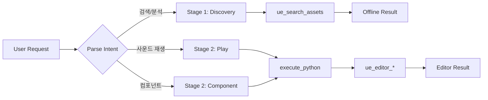

# Audio Workflow Skill

**Status**: Beta
**Purpose**: Automate Unreal Engine audio playback and component management

---

## Purpose

Automates Unreal Engine audio setup using 2-tool orchestration:

1. **Offline Discovery** - Search existing audio assets with `ue_search_assets` (no Editor needed)
2. **Editor Operations** - Play sounds/manage components with `ue_editor_*` (Editor required)

**Key Benefits**:
- 86% less maintenance (skill-based vs operations)
- **Offline asset discovery** (NEW) - search SoundCue/SoundWave without Editor
- Full Unreal Audio API access
- Natural language triggers (Korean + English)
- Spatial audio configuration

---

## 🔍 Trigger Phrases

### Korean
- "사운드 재생", "효과음 재생", "소리 재생"
- "배경음악", "BGM 재생", "음악 재생"
- "공간 오디오", "3D 사운드"
- "앰비언트", "환경음", "배경음"
- "오디오 컴포넌트", "사운드 추가"
- "볼륨 조절", "소리 크기"
- **"오디오 검색", "사운드 에셋 찾기"** (NEW - Offline)

### English
- "play sound", "play effect", "play sfx"
- "play music", "play bgm", "background music"
- "spatial audio", "3d sound", "positional audio"
- "ambient sound", "atmosphere", "environment sound"
- "audio component", "add sound"
- "volume control", "set volume"
- **"search audio assets", "find sound cues"** (NEW - Offline)

---

## Workflow Diagram



### 2-Stage Workflow

| Stage | Tool | Editor Required | Purpose |
|-------|------|-----------------|---------|
| **Stage 1** | `ue_search_assets` | ❌ No | Audio asset discovery (offline) |
| **Stage 2** | `ue_editor_*` | ✅ Yes | Play sounds/manage components |

---

## MCP Tool Usage

```python
# Stage 1: Discover audio assets (offline, no Editor needed)
results = ue_search_assets(asset_type="audio", query="*explosion*")

# Stage 2: Play sound via Editor automation
ue_editor_automation(operation="execute_python", code="import unreal; unreal.GameplayStatics.play_sound_2d(...)")
```

---

## 🚀 Quick Example (30 seconds)

**User**: "폭발 효과음 재생해줘"

**Agent**:
```text
🔊 Audio Playback

Sound: /Game/Audio/SFX/Explosion_Large
Type: 3D Spatial Sound
Location: Selected Actor (BP_Barrel)
Volume: 1.0
Attenuation: 2000 units

✅ Sound played successfully!
Duration: 2.3 seconds
```

---

## 🔧 Workflow Steps

### Stage 1: Input Analysis (입력 분석)

1. **Parse request**: 사운드 타입, 위치, 볼륨 파악
2. **Determine playback type**: 2D (UI) vs 3D (Spatial)
3. **Locate sound asset**: 경로 확인 또는 검색

### Stage 2: Sound Playback

#### 2D Sound (UI/System)

```python
import unreal

def play_2d_sound(sound_path: str, volume: float = 1.0, pitch: float = 1.0) -> dict:
    """Play a 2D sound (non-spatial, UI sounds)."""
    try:
        sound = unreal.load_asset(sound_path)
        if not sound:
            return {"success": False, "error": f"Sound not found: {sound_path}"}

        world = unreal.EditorLevelLibrary.get_editor_world()
        unreal.GameplayStatics.play_sound_2d(
            world,
            sound,
            volume_multiplier=volume,
            pitch_multiplier=pitch
        )
        return {"success": True, "sound": sound.get_name(), "volume": volume, "pitch": pitch, "type": "2D"}
    except Exception as e:
        return {"success": False, "error": f"Failed to play sound: {str(e)}"}

# Example: play_2d_sound("/Game/Audio/UI/Click", volume=0.8)
```

#### 3D Sound (Spatial)

```python
import unreal

def play_3d_sound(sound_path: str, location: tuple, volume: float = 1.0) -> dict:
    """Play a 3D spatial sound at a specific location."""
    try:
        sound = unreal.load_asset(sound_path)
        if not sound:
            return {"success": False, "error": f"Sound not found: {sound_path}"}

        world = unreal.EditorLevelLibrary.get_editor_world()
        loc = unreal.Vector(location[0], location[1], location[2])

        unreal.GameplayStatics.play_sound_at_location(
            world,
            sound,
            loc,
            volume_multiplier=volume
        )
        return {"success": True, "sound": sound.get_name(), "location": location, "volume": volume, "type": "3D"}
    except Exception as e:
        return {"success": False, "error": f"Failed to play sound: {str(e)}"}

# Example: play_3d_sound("/Game/Audio/SFX/Explosion", (100, 200, 50))
```

### Stage 3: Audio Component Management

```python
import unreal

def add_audio_component(actor_name: str, sound_path: str, auto_play: bool = True) -> dict:
    """Add an AudioComponent to an actor for persistent sounds."""
    try:
        actors = unreal.EditorLevelLibrary.get_all_level_actors()
        target_actor = None

        for actor in actors:
            if actor.get_actor_label() == actor_name:
                target_actor = actor
                break

        if not target_actor:
            return {"success": False, "error": f"Actor not found: {actor_name}"}

        sound = unreal.load_asset(sound_path)
        if not sound:
            return {"success": False, "error": f"Sound not found: {sound_path}"}

        # Add AudioComponent
        audio_comp = target_actor.add_component_by_class(
            unreal.AudioComponent,
            manual_attachment=False,
            relative_transform=unreal.Transform(),
            transform_is_relative=True
        )

        if audio_comp:
            audio_comp.set_editor_property("sound", sound)
            audio_comp.set_editor_property("auto_activate", auto_play)
            audio_comp.set_editor_property("is_ui_sound", False)
            return {"success": True, "actor": actor_name, "sound": sound.get_name(), "auto_play": auto_play}

        return {"success": False, "error": "Failed to create AudioComponent"}
    except Exception as e:
        return {"success": False, "error": f"Failed to add audio component: {str(e)}"}

# Example: add_audio_component("Campfire_01", "/Game/Audio/Ambient/Fire_Loop", True)
```

### Stage 4: Verification

1. **Confirm playback**: 재생 상태 확인
2. **List audio components**: 액터의 오디오 컴포넌트 목록
3. **Volume check**: 볼륨 레벨 확인

---

## Sound Types

| Type | Class | Use Case |
|------|-------|----------|
| Sound Cue | `USoundCue` | Complex, layered audio with nodes |
| Sound Wave | `USoundWave` | Simple audio files (.wav, .ogg) |
| MetaSound | `UMetaSoundSource` | Procedural audio (UE5.1+) |
| Sound Class | `USoundClass` | Grouping and mixing |
| Sound Mix | `USoundMix` | Global mixing adjustments |
| Sound Attenuation | `USoundAttenuation` | Spatial falloff settings |

---

## Common Properties

| Property | Type | Range | Description |
|----------|------|-------|-------------|
| `volume_multiplier` | float | 0-2 | Volume scale |
| `pitch_multiplier` | float | 0.5-2 | Pitch scale |
| `attenuation_settings` | USoundAttenuation | - | Spatial falloff |
| `concurrency_settings` | USoundConcurrency | - | Instance limits |
| `sound_class` | USoundClass | - | Mix group |
| `auto_activate` | bool | True/False | Auto-play on spawn |
| `is_ui_sound` | bool | True/False | 2D UI sound flag |
| `attenuation_overrides` | - | - | Per-instance falloff |

---

## Performance Metrics

| Metric | Value | Notes |
|--------|-------|-------|
| **Time Savings** | 70-80% | 오디오 설정: 5분 → 1분 |
| **Accuracy** | 95%+ | 표준 오디오 재생 |
| **Coverage** | 85% | 주요 오디오 작업 |
| **Editor Required** | Yes | Remote Control 필수 |

**Before/After Comparison**:
- 수동: 에셋 찾기 → 드래그&드롭 → 속성 설정 (5분+)
- 자동: 트리거 → 즉시 재생/설정 (30초-1분)

---

## Activation Tests

### Should Activate ✅

| Query | Expected | Reason |
|-------|----------|--------|
| "사운드 재생해줘" | ✅ Activate | 핵심 트리거 |
| "효과음 재생" | ✅ Activate | SFX 재생 |
| "BGM 재생해줘" | ✅ Activate | 배경음악 |
| "3D 사운드 추가" | ✅ Activate | 공간 오디오 |
| "앰비언트 사운드 설정" | ✅ Activate | 환경음 |
| "play explosion sound" | ✅ Activate | 영어 트리거 |

### Should NOT Activate ❌

| Query | Correct Skill | Reason |
|-------|---------------|--------|
| "애니메이션 설정해줘" | animation-workflow | 다른 도메인 |
| "조명 추가해줘" | lighting-workflow | 라이팅 별도 |
| "Blueprint 분석해줘" | blueprint-flow | BP 분석 별도 |
| "성능 분석해줘" | insights-profiler | 프로파일링 별도 |
| "C++ 코드 생성" | code-generation | 코드 생성 별도 |

### Edge Cases ⚠️

| Query | Handling | Notes |
|-------|----------|-------|
| "소리" (단독) | Ask clarification | 재생/추가/설정 중 어떤 것인지 |
| "오디오 분석" | Check context | 오디오 분석 vs 성능 프로파일링 |
| "사운드 Blueprint" | Check context | 오디오 재생 vs MetaSound BP |

---

## Error Handling

| Error | Cause | Solution |
|-------|-------|----------|
| `Editor not connected` | Remote Control 비활성화 | Editor 실행 + RC 플러그인 활성화 |
| `Sound not found` | 잘못된 에셋 경로 | `ue_search_assets(audio)` 로 검색 |
| `No audio component` | 컴포넌트 추가 실패 | Actor 유효성 확인 |
| `Volume out of range` | 볼륨 값 범위 초과 | 0-2 범위로 조정 |
| `Attenuation error` | 감쇠 설정 오류 | Attenuation 에셋 확인 |

### Error Recovery Strategy

```text
1. Connection Error
   → ue_check_health() 로 서버 상태 확인
   → Editor Remote Control 설정 확인

2. Sound Not Found
   → ue_search_assets(asset_type="audio", query="*keyword*")
   → Content Browser에서 경로 확인

3. Playback Failed
   → PIE 모드에서 재시도
   → 사운드 에셋 유효성 확인
```

---

## Safety Considerations

- **Volume limits**: 과도한 볼륨 방지 (max 2.0)
- **Loop warning**: 무한 루프 사운드 경고
- **Editor preview**: PIE 없이도 프리뷰 가능
- **Resource management**: 동시 재생 인스턴스 제한 권장

---

## ⚠️ Common Failures

| 에러 유형 | 원인 | 해결 방법 |
|-----------|------|-----------|
| `Sound asset not found` | 잘못된 에셋 경로 또는 미임포트 | `ue_search_assets`로 정확한 경로 확인 |
| 소리 안 들림 | Volume 0 또는 Attenuation 범위 밖 | `volume_multiplier` 확인, 3D 사운드는 리스너 거리 확인 |
| `add_component_by_class` 실패 | 선택된 Actor 없음 또는 권한 부족 | `ue_editor_automation(operation="stop_play")` 실행 후 Actor 선택 확인, 재시도 |
| `execute_python` 타임아웃 | 에디터 응답 없음 | 에디터 프로세스 상태 확인 |
| MetaSound 로드 실패 | UE 5.1 미만 버전 사용 | `UMetaSoundSource`는 UE 5.1+ 필요, SoundCue 대안 사용 |
| Concurrency 제한 초과 | 동시 재생 인스턴스 초과 | `concurrency_settings` 조정 또는 기존 사운드 중지 후 재생 |

---

## Related Files

| Document | Status | Description |
|----------|--------|-------------|
| [REFERENCE.md](REFERENCE.md) | ✅ Complete | API reference and function signatures |
| [EXAMPLES.md](EXAMPLES.md) | ✅ Complete | Usage scenarios and examples |
| [ADVANCED.md](ADVANCED.md) | ✅ Complete | Spatial audio, attenuation, MetaSound, mixing |

---

## Related Skills

| Skill | Purpose |
|-------|---------|
| [animation-workflow](../animation-workflow/SKILL.md) | Animation setup |
| [lighting-workflow](../lighting-workflow/SKILL.md) | Light setup and GI |
| insights-profiler | Performance analysis |

**Skills Index**: [README.md](../README.md)

---

## Output Format

```
Audio Operation Report
──────────────────────
Action: Play Sound | Add Component | Search Assets
Target: <actor or asset name>

[Sound Details]
  Asset: <path>
  Type: 2D (UI) | 3D (Spatial)
  Volume: <value>
  Location: <coordinates or actor name>

[Result]
  Status: SUCCESS | FAILED
  Duration: <seconds>
  Component: <AudioComponent name> (if added)
```

## Error Recovery

| Error | Cause | Fallback |
|-------|-------|----------|
| `Sound not found` | Incorrect asset path or asset not imported | Use `ue_search_assets(asset_type="audio", query="*keyword*")` to find correct path |
| `Editor not connected` | Remote Control plugin disabled | Switch to Stage 1 only (offline asset discovery via `ue_search_assets`) |
| `No audio component` | Actor invalid or component creation failed | Verify actor exists with `ue_editor_actors`, confirm actor supports components |
| `MetaSound load failed` | UE version below 5.1 | Fall back to `USoundCue` alternative; MetaSound requires UE 5.1+ |

**Last Updated**: 2026-02-06
