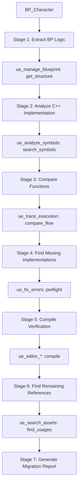

# BP → C++ Migration Validator

**Status**: Beta
**Purpose**: Validate that Blueprint logic was correctly migrated to C++

---

## Purpose

7-tool orchestration that **validates Blueprint → C++ migration completeness**:

- **Logic Extraction**: Extract BP node graph and logic flow
- **Code Comparison**: Compare against generated/written C++
- **Symbol Validation**: Verify all functions exist in C++
- **Execution Flow Comparison**: Ensure execution paths match
- **Error Detection**: Find missing implementations, broken references
- **Compile Verification**: Ensure C++ compiles correctly
- **Reference Update**: Find and update remaining BP references

**Critical Use Case**: Large-scale migrations where manual verification is error-prone.

---

## MCP Tool Usage

```python
# Stage 1: Extract Blueprint structure
bp_structure = ue_manage_blueprint(operation="get_structure", blueprint_name="BP_MyCharacter")

# Stage 2: Find corresponding C++ class
cpp_class = ue_analyze_symbols(operation="search_symbols", query="AMyCharacter")

# Stage 3: Generate C++ equivalent
cpp_code = ue_generate_code(operation="derive_class", base_class="ACharacter", class_name="AMyCharacter")

# Stage 4: Check for build issues
issues = ue_fix_errors(operation="preflight", project_root=".")
```

---

## Core vs Extended Workflow (v1.1.0)

The original 7-stage workflow is split into **Core (always runs)** and **Extended (conditional)**:

### Core Workflow (5-tool, Required)

| Stage | Tool | Purpose | On Failure |
|-------|------|---------|------------|
| 1 | `ue_manage_blueprint` | Extract BP structure | **Abort** (critical) |
| 2 | `ue_analyze_symbols` | Find C++ class | Warning only |
| 3 | `ue_search_assets` | Find references | Warning only |
| 4 | `ue_fix_errors(preflight)` | Check build issues | **Skip** if no logs |
| 5 | Report Generation | Migration Report | - |

### Extended Workflow (2-tool, Optional)

| Stage | Tool | Condition | Skip If |
|-------|------|-----------|---------|
| 3A | `ue_trace_execution` | `start_node` found | No entry point in BP |
| 5A | `ue_editor_*` | Editor connected | Offline mode |

### Why This Split?

- **Core 5-tool**: Always produces useful results (structure, symbols, references)
- **Extended 2-tool**: Requires specific conditions that may not be available
- **Result**: 4/7 fails → 5/5 Core success + clear skip indicators

---

## Parameter Auto-Detection (v1.1.0)

Each stage automatically infers required parameters from previous stage results:

### Parameter Resolution Order

| Stage | Parameter | Source | Fallback |
|-------|-----------|--------|----------|
| Stage 1 | `blueprint_name` | User input | Search by pattern |
| Stage 2 | `cpp_class_name` | **Auto: BP_X → AX** | Search `*X*` |
| Stage 3 | `start_node` | **Auto: EventGraph entry** | Skip Stage 3A |
| Stage 4 | `build_log_path` | **Auto: Latest log** | Use `preflight` mode |
| Stage 5 | `compile_target` | **Auto: Project name** | Skip compile |

Auto-detection logic: BP name `BP_X` generates candidates `[AX, UX, AXBase, X]`. Entry point candidates checked in order: EventGraph entry, BeginPlay node, Construction Script, first function.

---

## Trigger Phrases

### Korean
- "BP 변환 검증해줘"
- "Blueprint C++ 마이그레이션 확인"
- "BP_Character를 C++로 변환했는데 제대로 됐어?"
- "마이그레이션 완전성 검사"
- "BP → C++ 동작 비교"

### English
- "validate BP to C++ migration"
- "check Blueprint C++ conversion"
- "did I migrate BP_Character correctly?"
- "migration completeness check"
- "compare BP vs C++ behavior"

**Keywords**: `migration`, `BP to C++`, `conversion validation`, `마이그레이션`, `변환 검증`, `완전성`

---

## 7-Stage Workflow



### Stage Summary

| Stage | Tool | Goal |
|-------|------|------|
| 1. Extract BP Logic | `ue_manage_blueprint(get_structure)` | Get complete BP function list and logic flow |
| 2. Analyze C++ | `ue_analyze_symbols(search_symbols)` | Find corresponding C++ class and its methods |
| 3. Compare Flow | `ue_trace_execution(compare_flows)` | Ensure execution paths match between BP and C++ |
| 4. Find Issues | `ue_fix_errors(preflight)` | Check for missing declarations, broken references |
| 5. Compile | `ue_editor_automation(compile)` | Verify C++ compiles without errors |
| 6. Find Refs | `ue_search_assets(blueprint)` | Find all assets still referencing old Blueprint |
| 7. Report | — | Generate complete migration validation report |

**Detailed reference**: [REFERENCE.md](REFERENCE.md)
**Usage examples**: [EXAMPLES.md](EXAMPLES.md)

---

## Output Format

```text
Migration Validation Report: <BP_Name> → <CppClass>
────────────────────────────────────────────────────
| Stage                   | Status   | Details                       |
|-------------------------|----------|-------------------------------|
| 1. BP Structure         | PASS     | <N> functions, <N> variables  |
| 2. C++ Class Found      | PASS     | <class> (<N> matches)         |
| 3. References           | PASS     | <N> assets still reference BP |
| 4. Build Check          | SKIP     | <reason>                      |
| 3A. Flow Comparison     | SKIP     | <reason>                      |
| 5A. Compile Test        | SKIP     | <reason>                      |

Completeness: <X>% (Core <N>/5, Extended <N>/2)
Functions Migrated: <N>/<Total> (<X>%)
Variables Migrated: <N>/<Total> (<X>%)

Action Items:
  [CORE] Missing implementations
  [EXTENDED] Post-build validations
  [REFERENCES] Asset updates required
```

---

## Error Recovery

| Error | Cause | Recovery |
|-------|-------|----------|
| Blueprint not found | Incorrect BP name or asset not in metadata cache | Use `ue_search_assets(asset_type="blueprint", query="*Character*")` to find correct name |
| C++ class not found | Class name inference failed (BP_X -> AX mapping) | Use `ue_analyze_symbols(operation="search_symbols", query="*Character*")` with broader pattern |
| Compile verification failed | Build errors in migrated C++ code | Run `ue_fix_errors(mode="smart")` for auto-diagnosis and fix suggestions |
| No build log available | Project not built since migration | Skip Stage 4; use `ue_fix_errors(mode="preflight")` for static analysis instead |

---

**Status**: Beta (New high-value 7-tool skill)
**Related**: Issue #4442
