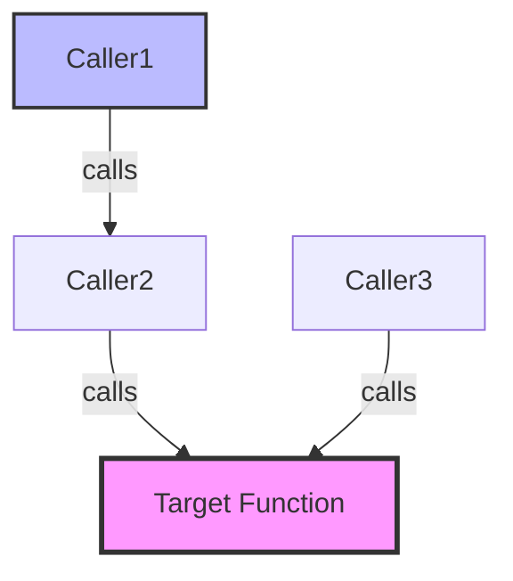

# Caller Graph Visualizer - Complete Reference

Complete workflow details, tool parameters, and safety guidelines.

---

## Complete Workflow Details

### Stage 1: Target Identification (Function Resolution)

**Purpose**: Identify the exact function or delegate to analyze.

**Tool Call**:

```python
ue_analyze_symbols(
    operation="search_symbols",
    query="*ApplyDamage*",      # Wildcard search
    symbol_type="function"      # Optional filter
)
```

**Parameters** (top-level — the dispatcher does not unwrap a `params={}` wrapper):

- `query` (required): Function name (supports wildcards)
- `symbol_type` (optional): Filter — `"class"`, `"function"`, `"enum"`, `"struct"`, `"typedef"`, `"variable"`. For delegates, use `operation="find_delegate_refs"` instead.
- `project_root` (optional): Project root path (auto-detected)

**Expected Output**:

```json
{
    "results": [
        {
            "name": "ApplyDamage",
            "class": "AMyCharacter",
            "signature": "void ApplyDamage(float Amount, AActor* Instigator)",
            "file": "MyCharacter.h",
            "line": 45,
            "module": "MyGame"
        }
    ]
}
```

**Response Template**:

```
🎯 Stage 1: Target Identified

Function: **[ClassName]::[FunctionName]**
Signature: `[ReturnType] [FunctionName]([Parameters])`
Location: [File]:[Line]

Proceeding to caller discovery...
```

---

### Stage 2: Caller Discovery (Direct Callers)

**Purpose**: Find all direct callers across C++ and Blueprint in one call.

**Tool Call**:

```python
ue_analyze_symbols(
    operation="find_callers",
    function_name="ApplyDamage",
    class_name="AMyCharacter"   # Optional, for disambiguation
)
```

**Parameters** (top-level — the dispatcher does not unwrap a `params={}` wrapper):

- `function_name` (required): Function name to analyze (unqualified names work)
- `class_name` (optional): Class name for disambiguation

Blueprint callers are included by default (no flag needed). **Delegate
call-sites that invoke the target function are already folded into
`find_callers` results** (SKILL.md § "What find_callers Already Returns" —
do **not** also call `find_delegate_refs` for the same function name; that is
redundant and burns the MCP budget). Use `operation="find_delegate_refs"` only
when the **target itself is a delegate symbol** (who binds / broadcasts this
delegate?), not when the target is a plain function. `find_callers` returns
**direct callers only** — deeper levels come from re-invoking it on each
discovered caller (this skill's "depth" = number of expansion rounds).

**Expected Output** (shape):

```json
{
    "success": true,
    "operation": "find_callers",
    "query": "ApplyDamage",
    "matched_function": "AMyCharacter::ApplyDamage",
    "match_type": "exact",
    "callers": [
        {
            "function": "AMyWeapon::FireWeapon",
            "file": "MyWeapon.cpp",
            "line": 123,
            "context": "Target->ApplyDamage(Damage, this);"
        }
    ],
    "callers_count": 1,
    "confidence_summary": { "pdb_count": 1, "tree_sitter_count": 0, "total": 1, "avg_confidence": 0.95 },
    "blueprint_callers": [
        {
            "blueprint_name": "BP_EnemyAI",
            "blueprint_path": "/Game/AI/BP_EnemyAI",
            "node_name": "Apply Damage",
            "owning_function": "Attack",
            "call_type": "direct"
        }
    ],
    "blueprint_callers_count": 1
}
```

**Response Template**:

```
📊 Stage 2: Caller Discovery Complete

Found **[N] direct callers** (expansion round [D]):

- C++ ([count]): [list of C++ callers]
- Blueprint ([count]): [list of Blueprint callers]
- Delegate call-sites ([count], included in find_callers): [list if present]

[If more rounds requested: re-invoke find_callers on each discovered caller]
[If the *target* is a delegate declaration: separately call find_delegate_refs]

Proceeding to impact visualization...
```

---

### Stage 3: Impact Visualization & Refactoring Advice

**Purpose**: Generate visual call graph and provide refactoring recommendations.

**Mermaid Diagram Generation**:



**Color Coding**:

- **Pink (#f9f)**: Target function (thick border)
- **Blue (#bbf)**: Top-level callers
- **Green (#9f9)**: Blueprint callers
- **Yellow (#ff9)**: Delegate broadcasts

**Refactoring Advice Template**:

```
🔧 Refactoring Impact Analysis

Target Function: [ClassName]::[FunctionName]
Impact Scope: [N] total callers ([C] C++, [B] Blueprint, [D] Delegate)

Safe Refactoring Options:
✅ Rename (use the caller list above as the checklist)
   - Update the [C] C++ call sites via IDE/manual rename
   - Manual update: Blueprint nodes ([B])
   - Verify: re-run ue_analyze_symbols(operation="find_callers", function_name="[OldName]")
   - Accept 0 callers only when the response is non-degraded, non-truncated, and unambiguous;
     otherwise the verification result is unknown and needs disambiguation/fallback

✅ Add parameter (Safe with default value)
   - C++ callers: No immediate changes (default value)
   - Blueprint callers: Auto-upgrade on recompile

⚠️ Change signature (Breaking change)
   - Requires manual update of all [N] callers
   - Blueprint nodes show errors until fixed

❌ Remove function (High impact)
   - [N] callers break immediately
   - Requires alternative implementation

Recommendation: [Based on caller count and impact]
```

---

## Tool Parameter Reference

### `ue_analyze_symbols` Operations

**`operation="search_symbols"`**:

- Purpose: Find function by name (wildcards supported)
- Returns: Function signature, location, module

**`operation="find_callers"`**:

- Purpose: Find all direct callers (C++ + Blueprint + delegate call-sites into the function)
- Returns: Flat caller list; re-invoke on discovered callers for deeper rounds
- Do **not** pair with `find_delegate_refs` for the same function target (redundant)

**`operation="find_delegate_refs"`**:

- Purpose: Track **delegate-symbol** declarations, bindings, and broadcasts
- Use when the analysis target **is** a delegate (not a function whose callers already include delegate edges)
- Returns: Delegate flow references for that delegate symbol

**`operation="export_symbol_graph"`** (explicit opt-in write):

- Purpose: Write a whole-symbol graph as DOT or JSON under `Saved/SymbolGraphs`
- Do not use for ordinary interactive caller diagrams; the normal Mermaid path is read-only
- Complete artifact contract: `success && written && !degraded &&
  !counts.truncated && !counts.provenance_bulk_truncated`
- `written:false` → no artifact; fall back to the in-memory graph
- Written with either truncation flag → artifact is **PARTIAL**, never proof that an edge/symbol is absent
- Existing outputs are not overwritten. The server derives the filename; on
  `output_exists`, report the returned `file_path` and do not invent
  `output_name` or delete the artifact without user authorization.

---

## Recursive Depth Guidelines (Detailed)

> **Depth = expansion rounds performed by this skill**, not a tool parameter:
> `find_callers` returns direct callers; each further level is another
> `find_callers` invocation on the callers discovered in the previous round.

### Performance vs Coverage Analysis

**Depth 1**:

- **Time**: 3-8 seconds
- **Callers**: 1-5 typical
- **Use Case**: Quick impact check
- **Example**: "Is this function used?"

**Depth 2** (Recommended):

- **Time**: 15-30 seconds
- **Callers**: 5-15 typical
- **Use Case**: Standard refactoring analysis
- **Example**: "What breaks if I change this?"

**Depth 3**:

- **Time**: 35-90 seconds
- **Callers**: 15-50 typical
- **Use Case**: Comprehensive impact analysis
- **Example**: "Complete dependency chain?"

**Depth 4**:

- **Time**: 75-180 seconds
- **Callers**: 50-200 typical
- **Use Case**: Deep dependency analysis
- **Example**: "Full project-wide impact?"

**Depth 5** (Maximum):

- **Time**: 150-300 seconds
- **Callers**: 200+ typical
- **Use Case**: Extreme cases only
- **Example**: "Core engine function usage?"

**Recommendation**: Use depth=2 for 90% of cases.

---

## Accuracy Details

### C++ Analysis

**Primary Method**: tree-sitter AST parsing

**Coverage**: 70-80% accurate

**Strengths**:

- Direct function calls: 95% accuracy
- Static method calls: 90% accuracy
- Member function calls: 85% accuracy

**Limitations**:

- Function pointers: Not tracked
- Virtual functions: Base function only
- Macro-generated calls: May miss

**Fallback**: PDB caller hints (+10-15% coverage)

---

### Blueprint Analysis

**Primary Method**: Kismet bytecode parser

**Coverage**: 100% accurate

**Strengths**:

- Blueprint → C++ calls: 100%
- Blueprint → Blueprint calls: 100%
- Event bindings: 100%

**No Limitations**: Complete Blueprint metadata available

---

### Delegate Analysis

**Primary Method**: Full delegate tracking (Issue #107)

**Coverage**: 100% accurate

**Strengths**:

- Delegate declarations: 100%
- Delegate bindings: 100%
- Delegate broadcasts: 100%

**No Limitations**: Complete lifecycle tracked

---

## Safety & Best Practices

### Read-Only Analysis

**Guarantees**:

- ✅ 100% read-only (no project modifications)
- ✅ Safe on production projects
- ✅ No side effects

**What is Read**:

- C++ source code (tree-sitter parsing)
- PDB symbol indices (pre-generated)
- Blueprint metadata (Commandlet output)
- Delegate declarations (source + metadata)

**What is NOT Modified**:

- No file writes
- No code modifications
- No Blueprint edits

---

### Performance Considerations

**Optimization Strategies**:

```python
# Cached data reuse
if pdb_index_exists():
    reuse_pdb_index()  # No re-parsing
if blueprint_metadata_cached():
    load_from_cache()  # No re-indexing

# Parallel analysis (where possible)
await asyncio.gather(
    analyze_cpp_callers(),
    analyze_blueprint_callers(),
    analyze_delegate_callers()
)
```

**Typical Performance** (last-contact-prod):

- Depth=1: ~5 seconds
- Depth=2: ~15 seconds
- Depth=3: ~35 seconds
- Depth=4: ~75 seconds
- Depth=5: ~150 seconds

---

## External Links

**Unreal Engine Documentation**:

- [Delegates](https://dev.epicgames.com/documentation/en-us/unreal-engine/delegates-in-unreal-engine)
- [Blueprint Technical Guide](https://dev.epicgames.com/documentation/en-us/unreal-engine/blueprint-technical-guide-in-unreal-engine)

**NarshaMCP Documentation**:

- [Policy Tools Cheatsheet](../../../docs/reference/POLICY_TOOLS_OVERVIEW.md)
- Unified Caller Tools
- Delegate Tracking (Issue #107)

**Related Issues**:

- [Issue #151: Caller Graph Visualizer](https://github.com/Next-Stage-Inc/ue-code-mcp/issues/151)
- [Issue #107: Delegate Tracking](https://github.com/Next-Stage-Inc/ue-code-mcp/issues/107)
- [Issue #11: Source-based Call Graph](https://github.com/Next-Stage-Inc/ue-code-mcp/issues/11)

---

**Version**: 1.0.0
**Status**: ✅ Production Ready
**Date**: 2025-10-22
