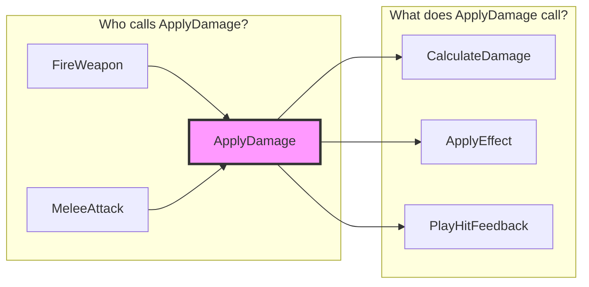

# Caller Graph Visualizer

**Purpose**: Visualize complete caller graphs for C++ ↔ Blueprint ↔ Delegate call flows
**Tools Used**: 2 (`ue_analyze_symbols` + `ue_manage_blueprint`)

---

## 🎯 Purpose

Understand **who calls what** and **refactoring impact** by tracing:

- **C++ function** → All callers (C++ functions, Blueprint nodes, Delegates)
- **Blueprint function** → All callers (other Blueprints, C++ code)
- **Delegate broadcasts** → All bound listeners

**Key Benefits**:

- 90-95% faster impact analysis (2-4 hours → 10-15 min)
- 100% cross-domain coverage (C++, Blueprint, Delegates)
- Visual Mermaid diagrams for call flow
- Recursive depth control (1-5 levels)
- Safe refactoring recommendations

---

## 🔍 Auto-Load Trigger Phrases

**Caller analysis queries**:

- "ApplyDamage 함수 누가 호출해?" / "Who calls ApplyDamage function?"
- "이 함수 수정하면 어디에 영향가?" / "What breaks if I modify this function?"
- "블루프린트에서도 이 함수 쓰는 곳 있어?" / "Is this function used in Blueprints?"

**Refactoring impact queries**:

- "이 함수 이름 바꿔도 돼?" / "Can I rename this function safely?"
- "리팩토링 영향 범위 분석해줘" / "Analyze refactoring impact"
- "이 함수 deprecated 하면 어디 고쳐야해?" / "What needs updating if I deprecate this?"

**Delegate tracing queries**:

- "OnDamageReceived 델리게이트 누가 bind 해?" / "Who binds to OnDamageReceived delegate?"
- "이 델리게이트 broadcast 하면 어떤 함수들 실행돼?" / "What functions run when this delegate broadcasts?"

**Keywords**: `caller`, `call graph`, `who calls`, `impact`, `refactoring`, `delegate`, `broadcast`, `bind`, `누가 호출`, `영향`, `리팩토링`, `델리게이트`

---

## CRITICAL RULES — Call Count Minimization (Issue #7122)

> **MANDATORY**: This skill MUST complete in **≤3 MCP calls** (Bash/Read excluded).
> Maximum: 3 MCP calls. Exceeding 3 is a **skill execution error**.

| # | Rule | Rationale |
|---|------|-----------|
| 1 | **Skip search_symbols** — `find_callers` accepts unqualified name and auto-matches all symbols | `search_symbols` is redundant; `find_callers` does its own resolution |
| 2 | **Early exit after find_callers** — if callers > 0, sufficient for refactoring assessment | Prevents redundant `find_virtual_overrides`/`find_cpp_to_bp` when data already present |
| 3 | **No duplicate operations** — same operation + same function name = skip | Prevents calling `find_callers` twice for same target |
| 4 | **MCP budget: max 3** — `find_callers`(1) + `find_virtual_overrides`(1, if virtual) + `find_cpp_to_bp`(1, if BP refs needed) | Callers-only queries need just 1 MCP call |

### Target Call Sequences

```text
Optimal (1 MCP call):              Standard (3 MCP calls):
1. find_callers                    1. find_callers
                                   2. find_virtual_overrides (if virtual)
                                   3. find_cpp_to_bp (if BP refs needed)
```

### What find_callers Already Returns (do NOT re-call individually)

| find_callers field | Equivalent individual operation | Status |
|---|---|---|
| `callers` (C++ call graph) | `search_symbols` + manual lookup | REDUNDANT — skip |
| `callers` (with delegates) | `find_delegate_refs` | REDUNDANT — skip |
| Blueprint callers (included by default) | `find_bp_references` | REDUNDANT — skip |

---

## 🧭 Optimized Workflow (2-Tool Orchestration)

### Complete Flow Path

```text
Stage 1:   Caller Discovery (PRIMARY)  → ue_analyze_symbols(find_callers) — ALWAYS
Stage 1b:  Virtual Override Check       → ue_analyze_symbols(find_virtual_overrides) — only if virtual
Stage 1c:  BP Cross-Reference          → ue_analyze_symbols(find_cpp_to_bp) — only if BP refs needed
Stage 2:   Callee Discovery (Optional)  → ue_analyze_symbols(find_callees) — only if bi-directional needed
Stage 3:   Impact Visualization         → Generate Mermaid diagram + refactoring advice (no MCP)
Stage 4:   Graph Artifact (Opt-in)       → ue_analyze_symbols(export_symbol_graph) — explicit write intent only
```

**2-Tool Orchestration**:
- `ue_analyze_symbols`: C++ 호출자 탐색, 가상 오버라이드 감지, 델리게이트 분석
- `ue_manage_blueprint`: BP 참조 검색 (fallback only — `find_callers` usually covers this)

---

### Stage 1: Caller Discovery (PRIMARY — always run first)

**Goal**: Find all direct callers across C++ and Blueprint

**Tool**: `ue_analyze_symbols(operation="find_callers", function_name="<unqualified name>")`

> `find_callers` accepts unqualified names (e.g., "ApplyDamage" not "AMyCharacter::ApplyDamage")
> and auto-matches ALL symbols with that name. No prior `search_symbols` needed.
> It returns **direct callers** — for deeper levels, re-invoke it on each discovered
> caller (skill "depth" = expansion rounds).

```python
# ONE call gets all direct callers (C++ and Blueprint)
ue_analyze_symbols(
    operation="find_callers",
    function_name="ApplyDamage"
)
```

**After this call, check results**:
- First classify the response using the shared consumer policy. If `success:false`,
  fall back. If `disambiguation.applied` is `false`, require a `class_name`/source
  choice instead of selecting the first match. When `applied:true`, consume the
  already-filtered callers even if `ambiguity_classes` records the pre-filter set.
- If any applicable `degraded`, `truncated`, `*_truncated`, or completeness flag says
  partial, retain returned callers as positive evidence and disclose the limitation,
  but **never** interpret zero callers as proof of no usage.
- callers > 0 with complete evidence → **proceed to Stage 3** (skip Stages 1b/1c unless specifically needed)
- callers == 0 with complete evidence → check Error Recovery table below

**Output**:

```text
📊 Stage 1: Caller Discovery Complete

Found **6 callers** at depth 2:

C++ Callers:
- Depth 1: AMyWeapon::FireWeapon (MyWeapon.cpp:123)
- Depth 2: APlayerController::HandleAttackInput → AMyWeapon::FireWeapon
- Delegate: OnDamageReceived broadcast

Blueprint Callers:
- BP_EnemyAI::Attack (K2Node_CallFunction_34)
- BP_PlayerCharacter::TakeDamage (K2Node_Event_12)
- BP_BossMonster::MeleeAttack (K2Node_CallFunction_78)
```

---

### Stage 1b: Virtual Override Detection (Conditional)

**When**: Target function is `virtual`/`override` AND you need override-specific impact

**Tool**: `ue_analyze_symbols(operation="find_virtual_overrides", function_name="ApplyDamage")`

```text
🔄 Virtual Override Detection

Target: AMyCharacter::ApplyDamage (virtual)
Override Count: 3 derived classes
- AMyHero::ApplyDamage, AMyEnemy::ApplyDamage, AMyBoss::ApplyDamage

⚠️ Warning: Modifying this function affects 3 overrides!
```

---

### Stage 1c: BP Cross-Reference (Conditional)

**When**: `find_callers` returned 0 BP callers but you suspect BP usage exists

**Tool**: `ue_analyze_symbols(operation="find_cpp_to_bp", function_name="ApplyDamage")`

> Only call this if `find_callers` missed BP references. Usually unnecessary.

---

### Stage 2: Callee Discovery (Optional, Bi-directional)

**When**: User asks "what does this function call?" or needs downstream impact

**Tool**: `ue_analyze_symbols(operation="find_callees", function_name="ApplyDamage")`

**Bi-directional Mermaid Diagram**:



---

### Stage 3: Impact Visualization (No MCP — analysis only)

**Goal**: Generate visual call graph and refactoring recommendations

**Output**:

```text
🔧 Refactoring Impact Analysis (Cross-Domain)

Target Function: AMyCharacter::ApplyDamage
Impact Scope: 6 total callers (2 C++, 3 Blueprint, 1 Delegate)

C++ Impact: 2 functions need signature update
Blueprint Impact: 3 nodes need reconnection
Delegate Impact: 1 broadcast listener

Safe Refactoring Options:
✅ Rename with auto-fix (Recommended) - C++ + Blueprint 자동 수정
✅ Add parameter (Safe with default value)
⚠️ Change signature (Breaking change - Blueprint 수동 수정 필요)
❌ Remove function (High impact)

Recommendation: Use "Rename with auto-fix" for safest refactoring.
```

---

### Stage 4: Whole-Graph Artifact (Optional, Write)

Use `export_symbol_graph` only when the user explicitly requests a DOT/JSON artifact.
Ordinary Mermaid visualization remains read-only and must not invoke this operation.

```python
ue_analyze_symbols(
    operation="export_symbol_graph",
    graph_kind="call",
    graph_format="json",
    graph_scope="all"
)
```

Treat the artifact as complete only when `success && written && !degraded &&
!counts.truncated && !counts.provenance_bulk_truncated`.

- `written:false` (including a degraded response) → fall back to the in-memory Mermaid graph; do not report an artifact.
- A written but truncated graph remains useful, but label it **PARTIAL** and prohibit absence/whole-project claims.
- The operation never overwrites an existing output. On `output_exists`, report
  the returned `file_path`; filenames are server-derived, so do not invent
  `output_name` or delete the existing artifact without user authorization.

---

## 📊 Recursive Depth Guidelines

| Depth | Use Case | Performance | Coverage |
|-------|----------|-------------|----------|
| **1** | Quick impact check | <5s | Direct callers only |
| **2** | Standard refactoring | ~15s | Direct + 1 level indirect |
| **3** | Comprehensive analysis | ~30s | 3-level call chains |
| **4** | Deep dependency analysis | ~60s | 4-level call chains |
| **5** | Full project analysis | ~2min | Maximum coverage |

**Recommendation**: Start with depth=2, increase if needed.

---

## Output Format

```text
=== Caller Graph: {FunctionName} ===

--- Stage 1: Caller Discovery (depth={N}) ---
C++ Callers: {count}
  {CallerClass}::{CallerFunc} → {TargetFunc}
BP Callers: {count}
  BP_{Name} → {NodeName} → {TargetFunc}

--- Stage 1b: Virtual Overrides (if applicable) ---
Overrides: {N} classes override this function
  - {ChildClass}::{FunctionName}

--- Stage 2: Callee Discovery (if requested) ---
Callees: {count}
  {TargetFunc} → {CalledFunc}

--- Stage 3: Impact Visualization ---
[Mermaid diagram or text tree]

Refactoring Safety: SAFE / CAUTION / DANGER
Affected: {N} C++ files, {N} Blueprints
```

## Error Recovery

| Error | Cause | Recovery |
|-------|-------|----------|
| `Symbol not found in PDB index` | Function name typo or not indexed | Use `ue_analyze_symbols(search_symbols, query="{name}")` with partial match to discover correct name |
| `find_callers returns 0 results` | Complete result may be genuinely unused; partial result is unknown | Only on complete evidence use `ue_manage_blueprint(find_bp_references)` as the final BP-side fallback; otherwise report unknown and retry/fallback |
| `find_callers returns too many/ambiguous results` | Common function name matches multiple classes | Use `search_symbols` first to disambiguate, require a class/source choice, then call `find_callers` with `class_name` |
| `export_symbol_graph` returns `written:false` | Degraded index, invalid path, or existing output | Fall back to Mermaid; for `output_exists`, report the returned path and never overwrite or delete without authorization |
| `find_cpp_to_bp returns 0` | Statics wrapper pattern (Issue #7068) | Check `efg_fallback` in response; if absent, convert CamelCase to display name ("FindTeam" → "Find Team") and use `find_nodes(title_pattern=displayName)` |
| `Recursive depth exceeds limit` | depth > 5 causes timeout on large projects | Start with depth=2; increase incrementally if needed |

---

## 📚 Related Files

For detailed information, see:

- **EXAMPLES.md** - Complete usage examples with Mermaid diagrams
- **ADVANCED.md** - Recursive analysis, refactoring strategies, integration
- **REFERENCE.md** - Complete tool parameters, accuracy details, safety guidelines

---

**Status**: ✅ Production Ready (Issue #7122 - MCP Call Optimization)
**Date**: 2026-03-21
**Changed**:
- CRITICAL RULES added: max 3 MCP calls (was 7), 41% cost savings ($0.80 → $0.48)
- Removed Stage 1 (search_symbols) — find_callers auto-resolves unqualified names
- Early exit after find_callers when callers > 0
- search_symbols moved to Error Recovery as disambiguation fallback
## MCP Tool Examples

```python
# Find Blueprint references for caller graph
ue_manage_blueprint(operation="smart", blueprint_name="BP_Player")
```
