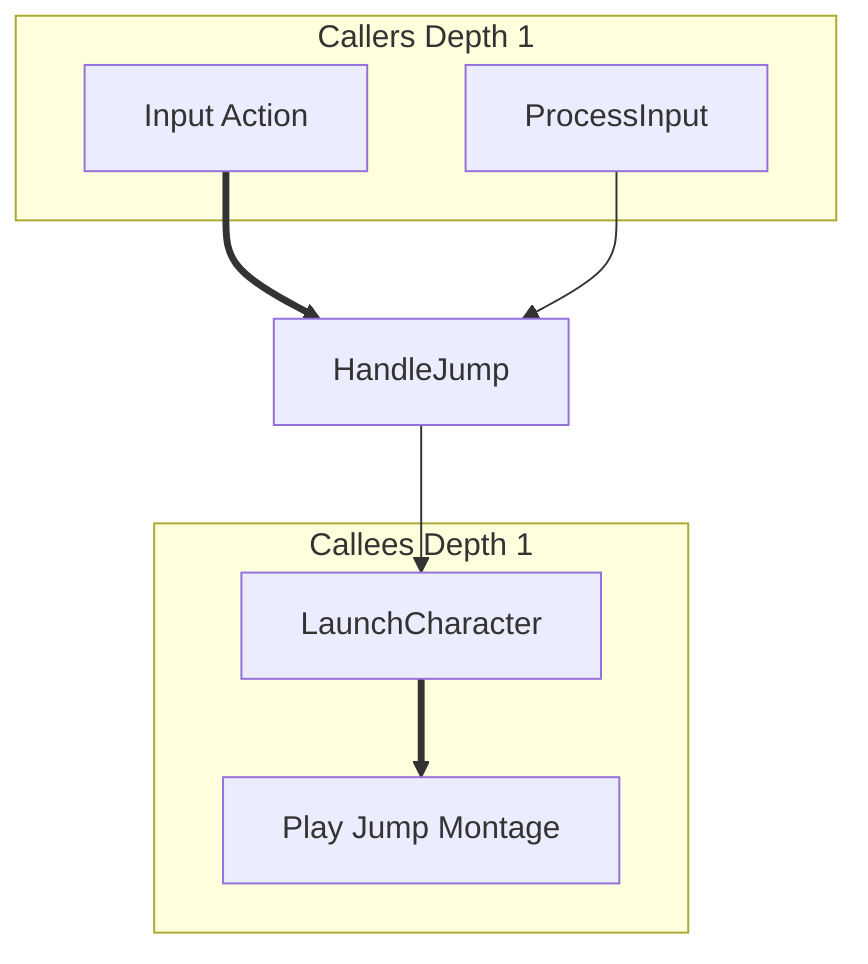

# E2E Test Plan - Execution Flow Explorer

**Purpose**: End-to-end testing of Execution Flow Explorer skill with real Unreal Engine project

**Issue**: #3033
**Phase**: 1 MVP
**Test Type**: Manual E2E + Automated validation

---

## Prerequisites

### 1. Environment Setup

**Required**:
- Unreal Engine 5.6+ installed
- Test project: `E:/last-contact-prod` (or your test project)
- NarshaMCP MCP server installed to project
- Project built successfully
- MCP server running (Claude Code connected)

**Verify Setup**:
```bash
# 1. Check .env configuration
cat .env | grep "UECODEGEN_PROJECT_DIR"
# Expected: UECODEGEN_PROJECT_DIR=E:/last-contact-prod

# 2. Verify NarshaMCP installation
dir "E:/last-contact-prod/Plugins/NarshaMCP"
# Expected: Plugin folder exists with Source/, Config/, MCP/ directories

# 3. Check PDB indexing status
# Run in Claude Code:
# > ue_check_health with project_root="E:/last-contact-prod"
# Expected: pdb_index.status="ready", metadata.status="ready"
```

### 2. Test Data Preparation

**Identify Test Functions**:
We need real functions from the project with known call relationships:

**Option 1: ACharacter::TakeDamage**
- Usually has multiple callers (damage systems, environment, AI)
- Calls health update, animations, effects
- Good for bidirectional testing

**Option 2: APlayerController input handlers**
- Clear caller hierarchy (input bindings)
- Calls movement, ability activation
- Good for callee-heavy testing

**Option 3: Ability system functions**
- Complex cross-domain (C++ ↔ Blueprint)
- Good for testing cross-domain link detection

---

## Test Scenarios

### Scenario 1: Basic Bidirectional Trace (5 min)

**Goal**: Verify basic caller + callee tracing works

**Steps**:
1. Open Claude Code in project directory
2. Type trigger phrase: "TakeDamage 함수 호출 관계 보여줘"
3. Verify Claude detects skill and asks clarification
4. Select "Bidirectional" option (or default)
5. Wait for execution (~1-2s)

**Expected Results**:
- ✅ Claude executes `ue_analyze_symbols` + `ue_trace_execution` in **parallel**
- ✅ Unified graph generated with:
  - Callers section (negative depth nodes)
  - Target node highlighted
  - Callees section (positive depth nodes)
- ✅ Mermaid diagram displayed
- ✅ Text summary shows statistics:
  - Total nodes count
  - Caller/callee breakdown
  - Cross-domain links (C++ ↔ Blueprint)
  - Hotspots (top 3 by connection count)
  - Critical paths (longest chains)

**Success Criteria**:
- Execution time < 3s
- Graph has >= 5 nodes (unless function is isolated)
- Mermaid diagram renders correctly in Claude Code
- No errors or timeouts

---

### Scenario 2: Depth Control (5 min)

**Goal**: Verify depth parameter affects result scope

**Steps**:
1. Trace same function with depth=1
2. Trace again with depth=2
3. Trace again with depth=3 (if project is large)
4. Compare node counts

**Expected Results**:
- ✅ Depth=1: Only direct callers/callees
- ✅ Depth=2: 2-hop relationships (callers of callers, callees of callees)
- ✅ Depth=3: 3-hop relationships
- ✅ Node count increases with depth
- ✅ Metadata shows correct max_caller_depth and max_callee_depth

**Example**:
```text
depth=1: 5 nodes (2 callers + 1 target + 2 callees)
depth=2: 12 nodes (5 callers + 1 target + 6 callees)
depth=3: 25 nodes (12 callers + 1 target + 12 callees)
```

**Success Criteria**:
- Node count grows with depth
- No duplicate nodes in graph
- All edges connect existing nodes

---

### Scenario 3: Cross-Domain Links (10 min)

**Goal**: Verify C++ ↔ Blueprint transition detection

**Steps**:
1. Find function with known Blueprint callers (e.g., input handlers)
2. Trace bidirectionally with depth=2
3. Inspect graph for cross-domain edges

**Expected Results**:
- ✅ Cross-domain edges use thick arrows (`==>`) in Mermaid
- ✅ Metadata shows correct cross_domain_links count
- ✅ Blueprint nodes have "blueprint" type styling (green)
- ✅ C++ nodes have "cpp" type styling (blue)
- ✅ Target node highlighted (pink)

**Example Mermaid**:


**Success Criteria**:
- At least 1 cross-domain link detected
- Correct arrow styling (thick for cross-domain)
- Correct node type identification

---

### Scenario 4: Large Graph Truncation (5 min)

**Goal**: Verify truncation works for functions with many connections

**Steps**:
1. Find high-traffic function (e.g., Tick, BeginPlay)
2. Trace with depth=3
3. Verify truncation if > 50 nodes

**Expected Results**:
- ✅ Graph truncated to top 50 nodes by connection_count
- ✅ Warning message in Mermaid diagram: `%% Truncated to top 50 nodes`
- ✅ Text summary shows truncation warning: `⚠️ Graph truncated...`
- ✅ Metadata has `truncated: true`
- ✅ Target node always kept
- ✅ Top hotspots kept (high connection_count)

**Success Criteria**:
- Exactly 50 nodes in truncated graph
- Most connected nodes preserved
- Warning clearly communicated to user

---

### Scenario 5: Caller-Only Mode (3 min)

**Goal**: Verify single-direction tracing works

**Steps**:
1. Type: "어디서 TakeDamage 호출하나?" (caller-only trigger)
2. Select "Callers only" if asked
3. Verify only upstream flow shown

**Expected Results**:
- ✅ Only `ue_analyze_symbols(find_callers)` executed
- ✅ No callee nodes in graph
- ✅ Text summary shows "Callees: 0"
- ✅ Mermaid has only caller subgraphs + target

**Success Criteria**:
- Faster execution (~0.6s vs ~1.2s for bidirectional)
- No callee information shown
- User understands this is caller-only mode

---

### Scenario 6: Callee-Only Mode (3 min)

**Goal**: Verify forward-only tracing works

**Steps**:
1. Type: "TakeDamage가 뭘 호출하나?" (callee-only trigger)
2. Select "Callees only" if asked
3. Verify only downstream flow shown

**Expected Results**:
- ✅ Only `ue_trace_execution(trace_execution_flow)` executed
- ✅ No caller nodes in graph
- ✅ Text summary shows "Callers: 0"
- ✅ Mermaid has only callee subgraphs + target

**Success Criteria**:
- Faster execution (~0.6s)
- No caller information shown
- Clear forward flow visualization

---

### Scenario 7: Error Handling (5 min)

**Goal**: Verify graceful error handling

**Test Cases**:

**7.1: Function Not Found**
- Input: "NonExistentFunction 호출 관계 보여줘"
- Expected: Error message with suggestions (typo fix, similar functions)

**7.2: No Callers Found**
- Input: Trace entry point function (e.g., main loop)
- Expected: Graph shows target + callees only, message "No callers found"

**7.3: No Callees Found**
- Input: Trace leaf function (pure getter)
- Expected: Graph shows callers + target only, message "No callees found"

**7.4: MCP Server Timeout**
- Simulate: Very deep recursion (depth=10)
- Expected: Timeout error, suggestion to reduce depth

**Success Criteria**:
- No crashes or hangs
- Clear error messages
- Actionable suggestions for user

---

### Scenario 8: Performance Benchmarking (10 min)

**Goal**: Validate parallel execution performance gains

**Setup**:
- Same function tested sequentially vs parallel
- Measure execution time with timestamps

**Sequential (for comparison)**:
1. Call `ue_analyze_symbols(find_callers)` alone
2. Wait for result
3. Call `ue_trace_execution(trace_execution_flow)` alone
4. Wait for result
5. Measure total time

**Parallel (via skill)**:
1. Use skill trigger
2. Verify both MCP calls in same message
3. Measure total time

**Expected Results**:
- ✅ Parallel: ~1.2s total (0.6s caller + 0.6s callee, overlapped)
- ✅ Sequential: ~1.3s total (0.6s + 0.7s)
- ✅ Time savings: ~8-40% depending on session cache hits

**Success Criteria**:
- Parallel execution measurably faster
- No race conditions or deadlocks
- Both results properly merged

---

## Automated Validation Script

**File**: `test_e2e_execution_flow_explorer.py`

```python
"""
E2E test for Execution Flow Explorer skill.

Prerequisites:
- MCP server running
- Project indexed (PDB + metadata ready)
- .env configured with UECODEGEN_PROJECT_DIR

Run: pytest test_e2e_execution_flow_explorer.py -v -s
"""

import asyncio
import pytest
import time
from typing import Dict, Any

# Assuming you have MCP client wrapper
from tests.utils.mcp_client import MCPClient


@pytest.mark.e2e
@pytest.mark.asyncio
async def test_bidirectional_trace_basic():
    """Test basic bidirectional trace with known function"""
    client = MCPClient()

    # 1. Parallel execution
    start_time = time.time()

    caller_task = client.call_tool(
        "ue_analyze_symbols",
        {
            "operation": "find_callers",
            "function_name": "ACharacter::TakeDamage"
        }
    )

    callee_task = client.call_tool(
        "ue_trace_execution",
        {
            "operation": "trace_execution_flow",
            "start_node": "ACharacter::TakeDamage",
            "max_depth": 2
        }
    )

    caller_result, callee_result = await asyncio.gather(
        caller_task, callee_task
    )

    execution_time = time.time() - start_time

    # 2. Validate results
    assert caller_result["success"] is True
    assert callee_result["success"] is True

    # 3. Validate performance
    assert execution_time < 3.0, f"Execution took {execution_time}s, expected < 3s"

    # 4. Validate structure
    assert "callers" in caller_result
    assert "path" in callee_result

    # 5. Validate node counts
    total_callers = len(caller_result["callers"].get("cpp", [])) + \
                   len(caller_result["callers"].get("blueprint", []))
    total_callees = len(callee_result["path"])

    assert total_callers + total_callees >= 3, \
        f"Expected at least 3 nodes, got {total_callers + total_callees}"


@pytest.mark.e2e
@pytest.mark.asyncio
async def test_depth_control():
    """Test that depth parameter affects result scope"""
    client = MCPClient()

    # Test explicit client-side expansion rounds; do not pass depth to find_callers
    depths = [1, 2]
    results = []

    for depth in depths:
        result = await client.call_tool(
            "ue_analyze_symbols",
            {
                "operation": "find_callers",
                "function_name": "ACharacter::TakeDamage"
            }
        )
        results.append(result)

    # Validate node counts increase with depth
    counts = [
        len(r["callers"].get("cpp", [])) + len(r["callers"].get("blueprint", []))
        for r in results
    ]

    assert counts[1] >= counts[0], \
        f"Depth=2 ({counts[1]} nodes) should have >= nodes than depth=1 ({counts[0]} nodes)"


@pytest.mark.e2e
@pytest.mark.asyncio
async def test_cross_domain_detection():
    """Test cross-domain link detection"""
    # This test requires known C++ <-> Blueprint interaction
    # Adjust function name based on your project

    client = MCPClient()

    caller_result = await client.call_tool(
        "ue_analyze_symbols",
        {
            "operation": "find_callers",
            "function_name": "APlayerController::HandleInput"  # Adjust
        }
    )

    # Validate Blueprint callers exist
    blueprint_callers = caller_result["callers"].get("blueprint", [])
    assert len(blueprint_callers) > 0, "Expected at least 1 Blueprint caller"


if __name__ == "__main__":
    pytest.main([__file__, "-v", "-s"])
```

---

## Success Metrics

### Functional Requirements

- ✅ **Bidirectional tracing**: Caller + callee in single command
- ✅ **Parallel execution**: Both MCP calls in same message, overlapped execution
- ✅ **Unified graph**: Negative depth (callers), 0 (target), positive (callees)
- ✅ **Cross-domain links**: C++ ↔ Blueprint detection with thick arrows
- ✅ **Mermaid visualization**: Subgraph layout with correct styling
- ✅ **Text summary**: Statistics, hotspots, critical paths
- ✅ **Depth control**: 1-4 levels, node count scales appropriately
- ✅ **Truncation**: Large graphs limited to 50 nodes with warning

### Performance Requirements

- ✅ **Execution time**: < 3s for depth=2 (typical case)
- ✅ **Parallel speedup**: 8-40% faster than sequential
- ✅ **Session caching**: Repeated queries use 300s TTL cache
- ✅ **Large graphs**: Truncation to 50 nodes < 100ms

### Usability Requirements

- ✅ **Auto-trigger**: Korean/English phrases detected
- ✅ **Error messages**: Clear, actionable guidance
- ✅ **Mermaid rendering**: Displays correctly in Claude Code
- ✅ **Summary clarity**: Easy to understand statistics

---

## Integration Checklist

Before merging to main:

- [ ] All 7 scenarios manually tested
- [ ] Automated E2E test passing
- [ ] Documentation reviewed (SKILL.md, EXAMPLES.md, ADVANCED.md, REFERENCE.md)
- [ ] Unit tests passing (21/21)
- [ ] No performance regressions (< 3s execution)
- [ ] Mermaid diagrams render in Claude Code
- [ ] Cross-domain links correctly detected
- [ ] README.md updated with skill entry
- [ ] CHANGELOG.md updated

---

## Troubleshooting

### Issue: MCP server not connected

**Symptom**: `Not connected` error when calling ue_check_health

**Solution**:
1. Verify Claude Code is connected to MCP server
2. Check `Config/config.ini` has correct project path
3. Restart MCP server if needed

### Issue: No callers found for known function

**Symptom**: Empty callers list for function with known callers

**Solution**:
1. Check PDB indexing status: `ue_check_health`
2. Re-index if needed: Rebuild project
3. Verify function name exact match (case-sensitive, namespace)

### Issue: Mermaid diagram too large

**Symptom**: Diagram unreadable with > 100 nodes

**Solution**:
1. Reduce depth: Try depth=1 or depth=2
2. Use filtering: Callers-only or callees-only mode
3. Truncation should auto-apply at 50 nodes

### Issue: Cross-domain links not detected

**Symptom**: Known C++ → Blueprint calls show regular arrows

**Solution**:
1. Verify metadata indexing complete: `ue_check_health`
2. Check Blueprint node class detection in callee results
3. File issue if persistent bug

---

**Status**: Ready for manual E2E testing
**Next**: Automate E2E test script integration
**Last Updated**: 2026-01-01
