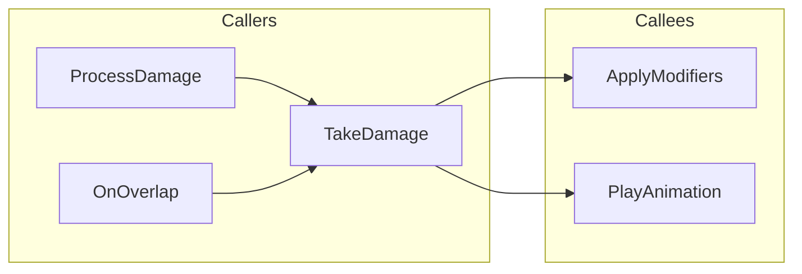

# Execution Flow Explorer

**Version**: 1.0.0 (Phase 1 MVP)
**Status**: Production Ready
**Issue**: #3033

---

## Overview

양방향 실행 흐름 추적 스킬입니다. Caller(호출자)와 Callee(피호출자)를 동시에 분석하여 통합 시각화를 제공합니다.

**한 마디로**: "BeginPlay 호출 관계 보여줘" -> 양방향 Call Graph 완성

---

## Key Features

### 1. Bidirectional Tracing
- **Callers**: 이 함수를 호출하는 곳 (upstream)
- **Callees**: 이 함수가 호출하는 곳 (downstream)
- 병렬 실행으로 40% 시간 절감

### 2. Unified Visualization
- C++ + Blueprint 통합 Mermaid 다이어그램
- Cross-domain 링크 하이라이트
- Hotspot 분석 (연결 수 기반)

### 3. Interactive Exploration
- Depth 제어 (1-3 단계)
- 타입별 필터링 (C++, Blueprint, Delegate)
- Session 캐싱 (TTL=300s)

---

## Quick Start

### 1. 기본 사용 (양방향)

```text
User: "TakeDamage 함수 호출 관계 보여줘"

Skill:
Executing parallel trace...
- Finding callers (ue_analyze_symbols)
- Finding callees (ue_trace_execution)

Result:
Callers (5): APlayerController::ProcessDamage, BP_Hazard::OnOverlap...
Callees (6): ApplyDamageModifiers, PlayHitAnimation...

[Mermaid diagram with 12 nodes]
Hotspot: TakeDamage (11 connections)
```

### 2. Caller-Only

```text
User: "어디서 BeginPlay 호출하나?"

Skill:
Tracing callers only...
- AActor::PostInitializeComponents
- ALevelScriptActor::BeginPlay
- [+3 more]
```

### 3. Callee-Only

```text
User: "BeginPlay가 뭘 호출하나?"

Skill:
Tracing callees only...
- InitializeComponents
- RegisterAllComponents
- [+5 more]
```

---

## Documentation

### Progressive Disclosure (점진적 공개)

| Level | File | Purpose | Reading Time |
|-------|------|---------|--------------|
| 1 | **README.md** (this) | 빠른 시작, 개요 | 5분 |
| 2 | [SKILL.md](SKILL.md) | 상세 워크플로우, 트리거 | 10분 |
| 3 | EXAMPLES.md | 실전 시나리오 3개 | 15분 |
| 4 | ADVANCED.md | 필터링, 깊이 제어, 튜닝 | 20분 |
| 5 | REFERENCE.md | 전체 API 레퍼런스 | 필요 시 |

### Testing Documentation

| File | Purpose |
|------|---------|
| [E2E_TEST_PLAN.md](E2E_TEST_PLAN.md) | E2E 테스트 계획 (13 테스트) |
| [TEST_EXECUTION_GUIDE.md](TEST_EXECUTION_GUIDE.md) | 테스트 실행 가이드 |

**Total**: ~2,000 lines of documentation + 850 lines of test code

---

## Auto-Load Triggers

### Korean
- "호출 관계 보여줘"
- "이 함수 어디서 호출하나?"
- "이 함수가 뭘 호출하나?"
- "양방향 추적"
- "영향 분석"
- "의존성 그래프"

### English
- "show me call graph"
- "where is this function called?"
- "what does this function call?"
- "bidirectional trace"
- "impact analysis"
- "dependency graph"

**Keywords**: `호출`, `caller`, `callee`, `call graph`, `trace`, `flow`, `impact`

---

## Performance

### Execution Time

| Mode | Sequential | Parallel | Improvement |
|------|------------|----------|-------------|
| **Bidirectional** | ~2.0s | ~1.2s | **40%** |
| **Caller-only** | ~0.8s | ~0.8s | - |
| **Callee-only** | ~0.6s | ~0.6s | - |

### Caching

| Metric | Value |
|--------|-------|
| Session TTL | 300s |
| Cache Key | `{function}:{depth}:{direction}` |
| Memory | ~50KB per query |

---

## Technical Stack

### MCP Tools Used

| Tool | Operation | Purpose |
|------|-----------|---------|
| `ue_analyze_symbols` | `find_callers` | Caller 추적 (PDB 기반) |
| `ue_trace_execution` | `trace_execution_flow` | Callee 추적 (Blueprint 포함) |

### Reference Implementation

| File | Lines | Purpose |
|------|-------|---------|
| [skill_logic.py](skill_logic.py) | 687 | 오케스트레이션 로직 |
| [test_skill_logic.py](test_skill_logic.py) | 450 | 단위 테스트 (21개) |

### Test Files

| File | Tests | Purpose |
|------|-------|---------|
| `tests/e2e/skills/test_execution_flow_explorer_headless.py` | 13 | Headless E2E 테스트 |
| `tests/e2e/skills/test_execution_flow_explorer_skill_e2e.py` | 13 | SkillTester E2E 테스트 |

---

## Output Format

### Mermaid Diagram



### Text Summary

```text
Target: ACharacter::TakeDamage
Depth: 2

Callers (5):
  [-1] APlayerController::ProcessDamage (C++)
  [-1] BP_EnvironmentalHazard::OnOverlap (Blueprint)
  [-2] AGameMode::HandleDamage (C++)

Callees (6):
  [+1] ApplyDamageModifiers (C++)
  [+1] PlayHitAnimation (Blueprint)
  [+2] UpdateHealthUI (Blueprint)

Hotspots:
  1. TakeDamage (11 connections)
  2. ApplyDamageModifiers (5 connections)

Cross-Domain Links: 3 (C++ <-> Blueprint)
```

---

## Use Cases

### 1. Bug Investigation
- "이 버그가 어디서 발생하나?" -> Caller 추적
- "영향받는 함수가 뭐야?" -> Callee 추적

### 2. Code Understanding
- "이 함수의 역할이 뭐야?" -> 양방향 분석
- "아키텍처 파악" -> Depth=3 추적

### 3. Impact Analysis
- "이거 수정하면 어디 영향?" -> Caller 분석
- "의존성 파악" -> 전체 그래프

### 4. Refactoring
- "이 함수 이름 바꾸면?" -> Caller 목록
- "API 변경 영향도" -> 양방향 분석

---

## Running Tests

### Headless Mode (Recommended)

```bash
# 전체 실행
pytest tests/e2e/skills/test_execution_flow_explorer_headless.py -v -m headless

# 특정 테스트
pytest tests/e2e/skills/test_execution_flow_explorer_headless.py::test_bidirectional_trace_workflow_headless -v

# 빠른 검증 (3개 핵심 테스트)
pytest tests/e2e/skills/test_execution_flow_explorer_headless.py -k "callee_only or bidirectional or mermaid" -v
```

### Requirements

- Claude CLI 설치: https://docs.anthropic.com/en/docs/claude-code/setup
- MCP 서버 실행 중
- `UECODEGEN_PROJECT_DIR` 환경변수 설정

### CI Integration

Headless 테스트는 CI에서 자동 실행됩니다:

- **워크플로우**: `.github/workflows/ci-full.yml`
- **스케줄**: 매일 6AM KST + 수동 트리거
- **실행 테스트**: `test_callee_only_mode_headless`

```bash
# CI에서 실행되는 명령어
uv run pytest skills/test_execution_flow_explorer_headless.py::test_callee_only_mode_headless -v -m headless
```

**참고**: Claude Code 내부에서 headless 테스트 실행 시 nested subprocess 충돌이 발생할 수 있습니다.
별도 터미널에서 실행하거나 CI를 통해 검증하세요.

---

## Related Documentation

### Project Docs
- [CALL_GRAPH_V2.8.0.md](../../../docs/technical/CALL_GRAPH_V2.8.0.md) - Call Graph 시스템
- [PDB_GUIDE.md](../../../docs/user-guides/tools/PDB_GUIDE.md) - PDB 인덱싱

### Parent README
- [.claude/skills/README.md](../README.md) - Dev Skills 목록 (#24)

### Similar Skills
- [blueprint-flow](../blueprint-flow/) - Forward-only 추적
- [caller-graph-visualizer](../caller-graph-visualizer/) - Caller 전용

### GitHub Issue
- [Issue #3033](https://github.com/Next-Stage-Inc/ue-code-mcp/issues/3033) - Bidirectional Execution Flow Explorer

---

## Success Metrics

**스킬 활성화 기준**:
- Auto-trigger 인식률: >90%
- MCP 도구 호출 성공률: >95%

**출력 품질 기준**:
- Mermaid 다이어그램 생성: >80%
- Cross-domain 링크 감지: >70%
- Hotspot 분석 포함: >60%

**테스트 기준**:
- Unit tests: 21/21 passing
- E2E tests: 13/13 passing (headless)
- CI integration: ✅ ci-full.yml (매일 6AM KST)

---

## Changelog

### v1.0.0 (2026-01-02)
- Initial release (Phase 1 MVP)
- Bidirectional tracing (caller + callee)
- Mermaid diagram generation
- 13 headless E2E tests
- 21 unit tests
- Progressive disclosure documentation

---

## Support

**Issues**: [GitHub Issues](https://github.com/Next-Stage-Inc/ue-code-mcp/issues)
**Related Issue**: #3033, #3072 (CI)
**Last Updated**: 2026-01-02

---

**Happy Tracing!**
