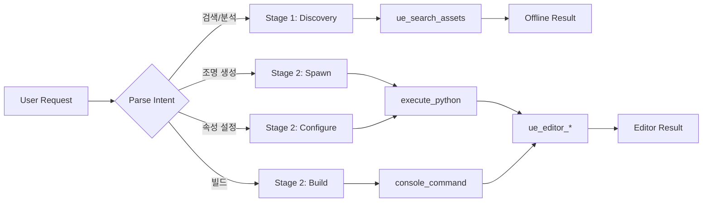

# Lighting Workflow Skill

**Status**: Beta
**Purpose**: Automate Unreal Engine lighting setup and configuration

---

## Purpose

Automates Unreal Engine lighting setup using 2-tool orchestration:

1. **Offline Discovery** - Search existing light assets with `ue_search_assets` (no Editor needed)
2. **Editor Operations** - Spawn/configure lights with `ue_editor_*` (Editor required)

**Key Benefits**:
- 86% less maintenance (skill-based vs operations)
- **Offline asset discovery** (NEW) - search light setups without Editor
- Full Unreal Python API access
- Natural language triggers (Korean + English)
- 3-point lighting setup in seconds

---

## 🔍 Trigger Phrases

### Korean
- "조명 추가", "조명 생성", "라이트 생성"
- "조명 밝기", "조명 색상", "조명 설정"
- "3점 조명", "스튜디오 라이팅"
- "라이팅 빌드", "조명 빌드"
- "조명 위치", "라이트 이동"
- **"라이트 검색", "조명 에셋 찾기"** (NEW - Offline)

### English
- "add light", "spawn light", "create light"
- "light intensity", "light color", "set light"
- "three point lighting", "studio lighting"
- "build lighting", "bake lights"
- "light position", "move light"
- **"search light assets", "find lighting setups"** (NEW - Offline)

---

## Workflow Diagram



### 2-Stage Workflow

| Stage | Tool | Editor Required | Purpose |
|-------|------|-----------------|---------|
| **Stage 1** | `ue_search_assets` | ❌ No | Light asset discovery (offline) |
| **Stage 2** | `ue_editor_*` | ✅ Yes | Spawn/configure/build lights |

---

## 🚀 Quick Example (30 seconds)

**User**: "캐릭터에 3점 조명 세팅해줘"

**Agent**:
```text
🎬 3-Point Lighting Setup

1. Key Light (주조명)
   - Type: SpotLight
   - Position: (300, -300, 400) - 45° 전방 좌측
   - Intensity: 10000 cd
   - Temperature: 5600K (daylight)

2. Fill Light (보조광)
   - Type: RectLight
   - Position: (-300, 300, 200) - 반대측 부드러운 광
   - Intensity: 3000 cd (Key의 30%)

3. Rim Light (역광)
   - Type: SpotLight
   - Position: (0, 300, 500) - 후방 상단
   - Intensity: 8000 cd

✅ 3 lights spawned successfully!
Total time: ~2 seconds
```

---

## 🔧 Workflow Steps

### Stage 1: Input Analysis (입력 분석)

1. **Parse request**: 조명 타입, 위치, 속성 파악
2. **Clarify if needed**: 타입 미지정 시 질문
3. **Prepare parameters**: 기본값 적용

### Stage 2: Light Spawning (조명 생성)

```python
import unreal

def spawn_light(light_type: str, location: tuple, intensity: float = 5000.0) -> dict:
    """Spawn a light actor in the level."""
    try:
        light_classes = {
            "point": unreal.PointLight,
            "spot": unreal.SpotLight,
            "directional": unreal.DirectionalLight,
            "rect": unreal.RectLight
        }

        light_class = light_classes.get(light_type.lower())
        if not light_class:
            return {"success": False, "error": f"Unknown light type: {light_type}", "valid_types": list(light_classes.keys())}

        location_vec = unreal.Vector(location[0], location[1], location[2])
        light = unreal.EditorLevelLibrary.spawn_actor_from_class(light_class, location_vec)

        # Set intensity
        light_comp = light.get_component_by_class(unreal.LightComponent)
        if light_comp:
            light_comp.set_editor_property("intensity", intensity)

        return {"success": True, "light_type": light_type, "name": light.get_name(), "intensity": intensity}
    except Exception as e:
        return {"success": False, "error": f"Failed to spawn light: {str(e)}"}

# Example: spawn_light("spot", (300, -300, 400), 10000)
```

### Stage 3: Property Configuration (속성 설정)

```python
def set_light_properties(light_name: str, **properties) -> dict:
    """Configure light properties by name."""
    try:
        actors = unreal.EditorLevelLibrary.get_all_level_actors()
        for actor in actors:
            if actor.get_actor_label() == light_name:
                light_comp = actor.get_component_by_class(unreal.LightComponent)
                if light_comp:
                    for prop, value in properties.items():
                        light_comp.set_editor_property(prop, value)
                    return {"success": True, "light": light_name, "updated_properties": properties}
        return {"success": False, "error": f"Light not found: {light_name}"}
    except Exception as e:
        return {"success": False, "error": f"Failed to set properties: {str(e)}"}

# Example: set_light_properties("SpotLight_1", intensity=8000, temperature=5600)
```

### Stage 4: Verification (검증)

1. **List created lights**: 생성된 조명 목록 출력
2. **Validate properties**: 속성 값 확인
3. **Optional preview**: 뷰포트에서 확인 안내

---

## Supported Light Types

| Type | Class | Use Case | Shadows |
|------|-------|----------|---------|
| Point | `unreal.PointLight` | Bulbs, lamps, torches | Soft |
| Spot | `unreal.SpotLight` | Flashlights, stage lights | Hard/Soft |
| Directional | `unreal.DirectionalLight` | Sun, moon (outdoor) | Cascaded |
| Rect | `unreal.RectLight` | Windows, softboxes, monitors | Very Soft |
| Sky | `unreal.SkyLight` | Ambient lighting | None |

---

## Common Properties

| Property | Type | Range | Description |
|----------|------|-------|-------------|
| `intensity` | float | 0-100000 | Brightness (cd for Point/Spot, lux for Directional) |
| `light_color` | FLinearColor | 0-1 RGB | Light color |
| `attenuation_radius` | float | 0-10000 | Falloff distance |
| `source_radius` | float | 0-1000 | Soft shadow size |
| `temperature` | float | 1500-15000 | Kelvin color temperature |
| `use_temperature` | bool | True/False | Enable temperature-based color |
| `cast_shadows` | bool | True/False | Enable shadow casting |
| `inner_cone_angle` | float | 0-80 | Spot light inner cone (degrees) |
| `outer_cone_angle` | float | 0-80 | Spot light outer cone (degrees) |

---

## Performance Metrics

| Metric | Value | Notes |
|--------|-------|-------|
| **Time Savings** | 75-85% | 3점 조명: 10분 → 2분 |
| **Accuracy** | 95%+ | 표준 라이팅 설정 |
| **Coverage** | 90% | 주요 조명 작업 |
| **Editor Required** | Yes | Remote Control 필수 |

**Before/After Comparison**:
- 수동: 라이트 생성 → 위치 조정 → 속성 설정 → 반복 (10-15분)
- 자동: 트리거 → 파라미터 입력 → 자동 생성 (1-2분)

---

## Activation Tests

### Should Activate ✅

| Query | Expected | Reason |
|-------|----------|--------|
| "조명 추가해줘" | ✅ Activate | 핵심 트리거 |
| "PointLight 생성" | ✅ Activate | 라이트 타입 명시 |
| "3점 조명 세팅" | ✅ Activate | 스튜디오 라이팅 |
| "라이팅 빌드해줘" | ✅ Activate | GI 빌드 |
| "조명 밝기 조절" | ✅ Activate | 속성 설정 |
| "spawn spotlight at origin" | ✅ Activate | 영어 트리거 |

### Should NOT Activate ❌

| Query | Correct Skill | Reason |
|-------|---------------|--------|
| "애니메이션 설정해줘" | animation-workflow | 다른 도메인 |
| "사운드 추가해줘" | audio-workflow | 오디오 별도 |
| "Blueprint 분석해줘" | blueprint-flow | BP 분석 별도 |
| "성능 분석해줘" | insights-profiler | 프로파일링 별도 |
| "C++ 코드 생성" | code-generation | 코드 생성 별도 |

### Edge Cases ⚠️

| Query | Handling | Notes |
|-------|----------|-------|
| "밝기 조절" (라이트 미지정) | Ask clarification | 어떤 라이트인지 확인 |
| "조명" (단독) | Ask clarification | 생성/수정/삭제 중 어떤 것인지 |
| "light" + "animation" | Check context | 라이팅 vs 애니메이션 라이트 |

---

## Error Handling

| Error | Cause | Solution |
|-------|-------|----------|
| `Editor not connected` | Remote Control 비활성화 | Editor 실행 + RC 플러그인 활성화 |
| `Light spawn failed` | 잘못된 좌표 또는 권한 | 좌표 범위 확인, 레벨 쓰기 권한 확인 |
| `Property not found` | 잘못된 속성명 | 정확한 UE 속성명 사용 |
| `Build lighting failed` | 라이트맵 해상도 문제 | Lightmap Resolution 조정 |
| `Actor not found` | 잘못된 라이트 이름 | `get_all_level_actors()`로 목록 확인 |

### Error Recovery Strategy

```text
1. Connection Error
   → ue_check_health() 로 서버 상태 확인
   → Editor Remote Control 설정 확인

2. Spawn Failed
   → 좌표 범위 확인 (너무 큰 값 방지)
   → 레벨이 열려있는지 확인

3. Property Error
   → 올바른 속성명 사용 (대소문자 주의)
   → unreal.LightComponent 문서 참조
```

---

## Safety Considerations

- **Non-destructive**: 기존 라이트 수정은 확인 후 진행
- **Undo support**: Editor Undo (Ctrl+Z) 지원
- **Build warning**: 라이팅 빌드는 시간 소요 사전 안내
- **Memory**: 과도한 라이트 생성 시 성능 경고

---

## ⚠️ Common Failures

| 에러 유형 | 원인 | 해결 방법 |
|-----------|------|-----------|
| `spawn_actor_from_class` 실패 | 잘못된 클래스명 또는 레벨 미로드 | `unreal.PointLight` 등 정확한 클래스 사용, 레벨 열림 확인 |
| Light 속성 변경 안됨 | Actor 대신 Component에 설정 필요 | `get_component_by_class(PointLightComponent)` 로 컴포넌트 접근 |
| `BuildLighting` 무응답 | GI 빌드 시간 초과 (대형 레벨) | `BuildLighting PREVIEW` 로 프리뷰 빌드 먼저 수행 |
| `execute_python` 타임아웃 | 에디터 응답 없음 또는 빌드 중 | 에디터 상태 확인, 백그라운드 작업 완료 대기 |
| 선택 Actor 없음 | `get_selected_level_actors()` 빈 배열 | 에디터에서 Actor 선택 후 재시도, 또는 이름으로 검색 |
| 잘못된 Color 값 | RGB 범위 오류 (0-255 vs 0-1) | `FLinearColor`는 0-1 범위 사용 |

---

## Output Format

```
=== Lighting Workflow Report ===

Action: {spawn|configure|build|search}
Light Type: {PointLight|SpotLight|DirectionalLight|RectLight}

--- Created/Modified Lights ---
| # | Name          | Type      | Position          | Intensity | Temp   |
|---|---------------|-----------|-------------------|-----------|--------|
| 1 | SpotLight_1   | Spot      | (300, -300, 400)  | 10000 cd  | 5600K  |
| 2 | RectLight_1   | Rect      | (-300, 300, 200)  | 3000 cd   | 4500K  |

Status: {N} lights spawned/configured successfully
```

## Error Recovery

| Error | Cause | Fallback |
|-------|-------|----------|
| Editor not connected (RC port 30010 closed) | Editor not running or Remote Control plugin disabled | Launch Editor first with `/launch-editor`; verify RC plugin in Edit > Plugins |
| `spawn_actor_from_class` fails | Invalid class name or level not loaded | Use exact UE class names (`unreal.PointLight`); verify level is open in Editor |
| Light property change has no effect | Setting property on Actor instead of LightComponent | Access component via `get_component_by_class(unreal.LightComponent)` before setting properties |

## Related Files

| Document | Status | Description |
|----------|--------|-------------|
| [REFERENCE.md](REFERENCE.md) | ✅ Complete | API reference and function signatures |
| [EXAMPLES.md](EXAMPLES.md) | ✅ Complete | Usage scenarios and examples |
| [ADVANCED.md](ADVANCED.md) | ✅ Complete | Lumen GI, ray tracing, volumetric lighting |

---

## Related Skills

| Skill | Purpose |
|-------|---------|
| [animation-workflow](../animation-workflow/SKILL.md) | Animation setup |
| [audio-workflow](../audio-workflow/SKILL.md) | Sound setup and spatial audio |
| insights-profiler | Performance analysis and optimization |

**Skills Index**: [README.md](../README.md)

---

**Last Updated**: 2026-02-06
## MCP Tool Examples

```python
# Search for lighting assets
ue_search_assets(asset_type="all", query="Light*")
# Manage actors in lighting workflow
ue_editor_actors(operation="smart", class_name="APointLight")
```
