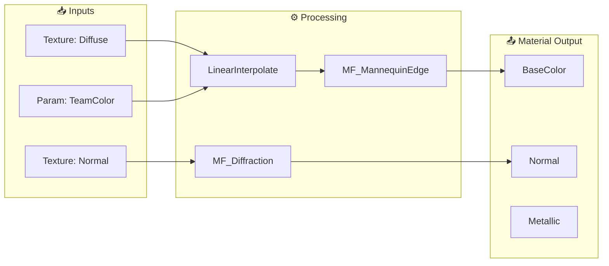

# Material Analysis Workflow

**Priority**: High
**Goal**: Provide comprehensive Material analysis with 3-part output

---

## Purpose

Orchestrates Material analysis for **complete understanding**:

1. **Hierarchy Summary** - Tree view of structure, nodes, children
2. **Mermaid Diagram** - Visual node flow (VSCode renderable)
3. **Performance Table** - Metrics with ratings and optimization suggestions

**Key Difference from Individual Tools**:
- **Individual Tools**: Manual tool calls, raw JSON output
- **Material Analysis Workflow**: Unified 3-part formatted output

---

## Trigger Phrases

### Korean

- "머테리얼 분석", "Material 분석"
- "M_Mannequin 분석해줘", "머테리얼 구조"
- "머테리얼 성능", "머테리얼 최적화"
- "머테리얼 노드 플로우", "머테리얼 흐름"

### English

- "material analysis", "analyze material"
- "analyze M_Mannequin", "material structure"
- "material performance", "material optimization"
- "material node flow", "material diagram"

---

## Workflow Overview

### 3-Phase Analysis Process

```text
Phase 1: Data Collection
│ Tools: get_hierarchy, get_nodes, analyze_performance
│ Output: Raw data from 3 MCP calls
↓
Phase 2: Data Processing
│ Count nodes by type
│ Extract MaterialFunction names
│ Calculate performance ratings
↓
Phase 3: Formatted Output
│ Part 1: Tree-view summary
│ Part 2: Mermaid diagram
│ Part 3: Performance table
```

---

## Tool Integration

### Primary Tools Used

| Tool | Operation | Purpose |
|------|-----------|---------|
| `ue_manage_material` | `get_hierarchy` | Parent/children relationships |
| `ue_manage_material` | `get_nodes` | Node structure and connections |
| `ue_manage_material` | `analyze_performance` | Complexity metrics |
| `ue_manage_material` | `get_graph_summary` | Stages + mermaid (#21972) |
| `ue_manage_material` | `get_hlsl` | HLSL code (Editor required) |

---

## Output Format

### Part 1: Hierarchy Summary

```text
📦 M_Mannequin (Material)
├─ 📊 Complexity: Very High (305 instructions)
├─ 🎨 Textures: 9 samples
├─ 📐 Nodes: 258 total
│   ├─ Parameter: 80
│   ├─ LinearInterpolate: 24
│   ├─ Multiply: 22
│   ├─ MaterialFunction: 11
│   ├─ TextureSample: 9
│   └─ Other: 112
├─ 🔗 MaterialFunctions:
│   ├─ MF_MannequinEdge
│   ├─ MF_Diffraction
│   ├─ MF_BaseColorFallOff
│   └─ ... (11 total)
└─ 👶 Children (3):
    ├─ MI_Manny_01
    ├─ MI_Manny_01_Red
    └─ MI_Manny_01_Blue
```

### Part 2: Mermaid Diagram



### Part 3: Performance Table

| Metric | Value | Rating | Recommended |
|--------|-------|--------|-------------|
| VS Instructions | 305 | 🔴 High | <200 |
| PS Instructions | 652 | 🔴 Very High | <500 |
| Texture Samples | 9 | 🟡 Medium | <8 |
| Samplers | 13 | 🟡 Medium | <16 |
| MaterialFunctions | 11 | - | Reference |

**Optimization Suggestions:**
- Consider texture atlasing to reduce sampler count
- Review expensive nodes for LOD variants
- Consider splitting into Material Layers

### Part 4: Flow Stage Split (Issue #14979 / #21972)

의미 단위 stage로 잘라 출력 핀 역할(색감/보임/모양/질감) 설명.
`get_graph_summary` → stages/output_chains/mermaid (서버 결정론); 스킬은 포맷만. [REFERENCE.md](REFERENCE.md).

### Part 5: 기능 카탈로그 (Issue #16326)

기능군→파라미터→기본값/범위→조합→끄는 법 + MI 패밀리 diff 표 (`compare_mi_family`+`get_nodes` 합성). [REFERENCE.md](REFERENCE.md).

---

## Implementation

### Step 1: Collect Data

```python
# Call MCP tools in parallel
hierarchy = ue_manage_material(operation="get_hierarchy", material_name="{name}")
nodes = ue_manage_material(operation="get_nodes", material_name="{name}")
performance = ue_manage_material(operation="analyze_performance", material_name="{name}")
```

### Step 2: Process Node Types

```python
# Count nodes by type
node_counts = {}
for node in nodes["nodes"]:
    node_type = node["node_type"]
    # Extract base type (e.g., "Multiply" from "MaterialExpressionMultiply")
    base_type = extract_base_type(node_type)
    node_counts[base_type] = node_counts.get(base_type, 0) + 1

# Extract MaterialFunction names
mf_names = [
    node["parameters"]["MaterialFunction"]
    for node in nodes["nodes"]
    if "MaterialFunction" in node.get("parameters", {})
]
```

### Step 3: Generate Rating

```python
RATING_THRESHOLDS = {
    "vs_instructions": [(100, "🟢"), (300, "🟡"), (float("inf"), "🔴")],
    "ps_instructions": [(300, "🟢"), (600, "🟡"), (float("inf"), "🔴")],
    "texture_samples": [(5, "🟢"), (10, "🟡"), (float("inf"), "🔴")],
    "samplers": [(8, "🟢"), (13, "🟡"), (float("inf"), "🔴")],
}

def get_rating(metric, value):
    for threshold, rating in RATING_THRESHOLDS[metric]:
        if value < threshold:
            return rating
    return "🔴"
```

### Step 4: Flow Stage Split (Issue #14979 / #21972)

```python
summary = ue_manage_material(operation="get_graph_summary", material_name="{name}")
# stages / output_chains / mermaid / shared_inputs — format Part 4; prefer mermaid as-is
```

서버 결정론 (MAT-08). 상세: [REFERENCE.md](REFERENCE.md).

### Step 5: 기능 카탈로그 (Issue #16326)

읽기 전용 `compare_mi_family`+`get_nodes` 합성. 끄는 법 역할귀속은 라이브 전용(오프라인 graceful-degrade). [REFERENCE.md](REFERENCE.md).

---

## Quick Example

**User**: "M_Mannequin 머테리얼 분석해줘"

**Material Analysis Workflow**:

1. **MCP Calls**:
   - `ue_manage_material(operation="get_hierarchy", material_name="M_Mannequin")`
   - `ue_manage_material(operation="get_nodes", material_name="M_Mannequin")`
   - `ue_manage_material(operation="analyze_performance", material_name="M_Mannequin")`

2. **Output**: [3-part formatted analysis as shown above]

---

## Performance Rating Thresholds

| Metric | 🟢 Good | 🟡 Medium | 🔴 High |
|--------|---------|-----------|---------|
| VS Instructions | <100 | 100-300 | >300 |
| PS Instructions | <300 | 300-600 | >600 |
| Texture Samples | <5 | 5-10 | >10 |
| Samplers | <8 | 8-13 | >13 |

---

## Error Recovery

| Error | Cause | Fallback |
|-------|-------|----------|
| Empty nodes returned from `get_nodes` | Material name not found in project assets | Use `ue_search_assets(query="M_*")` to verify correct material name before retry |
| HLSL extraction returns null | Editor not running (HLSL requires live Editor connection) | Skip HLSL analysis; report hierarchy and performance from binary parser data only |
| `analyze_performance` returns no metrics | Binary `.uasset` parse failure or corrupted asset | Verify `.uasset` file exists with `Glob`; re-save asset in Editor if corrupted |

## Common Failures

| Error Type | Cause | Solution |
|------------|-------|----------|
| Empty nodes | Material not found | Use `ue_search_assets` to verify name |
| No hierarchy | Not a Material | Only works on Material/MaterialInstanceConstant |
| HLSL null | Editor not running | Start Editor for HLSL analysis |
| Performance missing | Binary parse failed | Check .uasset file exists |

---

## Related Files

- **GT Tests**: `MCP/native/mcp_server/tests/material_consolidated_modules/material_lyra_gt.rs`
- **Comparison Tests**: `MCP/native/mcp_server/tests/material_consolidated_modules/material_hlsl_comparison.rs`
- **Validation Results**: `docs/validation/PHASE21_EDITOR_GROUND_TRUTH.md`

---

**Status**: Implementation Complete
**Last Updated**: 2026-02-07
