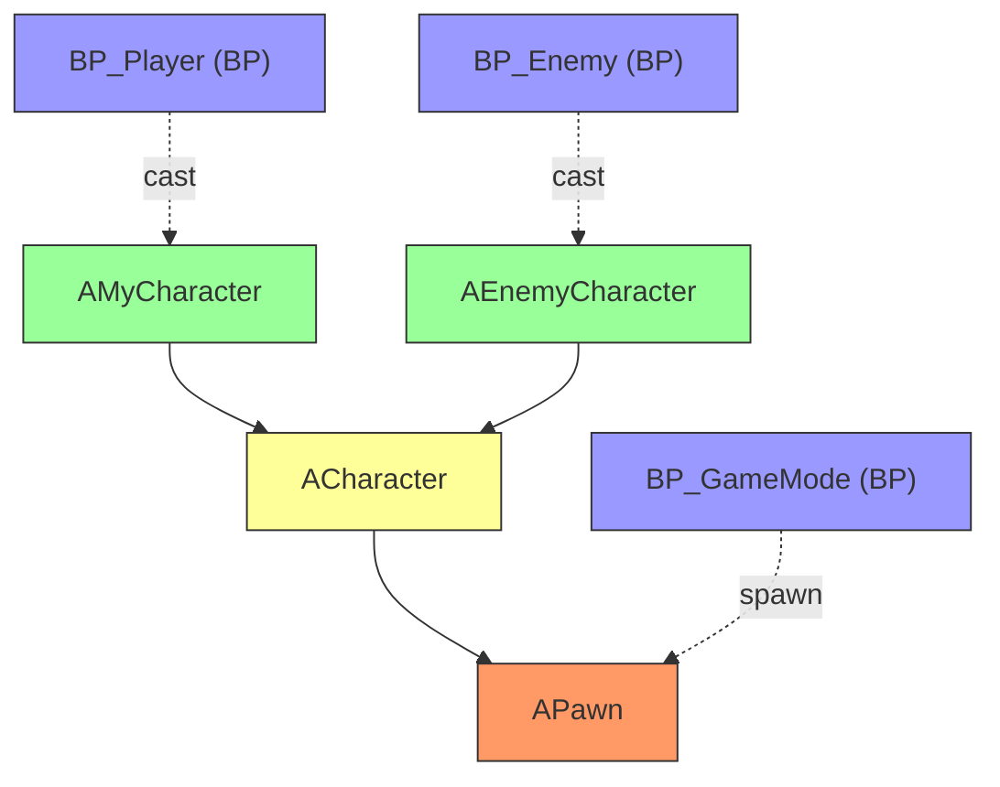
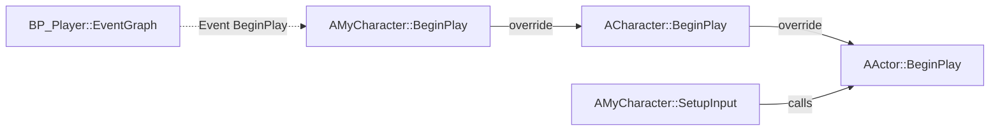

# Cross-Reference Graph Reference — --xref Mode Guide

**Issue**: #5292
**Parent Skill**: `/ue-impact` v1.1.0 (--xref mode)

---

## Overview

The `--xref` mode runs Phases 1-3 of `/ue-impact` without Phase 4 (risk scoring).
Instead of a risk assessment, it outputs a Mermaid dependency graph showing all references.

Use `--xref` when the user wants to **see** references, not **assess** risk.

---

## When to Use --xref vs. Full Mode

| User Intent | Mode | Output |
|-------------|------|--------|
| "누가 이걸 사용해?" | `--xref` | Reference graph (Mermaid) |
| "xref ACharacter" | `--xref` | Reference graph (Mermaid) |
| "참조 관계 보여줘" | `--xref` | Reference graph (Mermaid) |
| "바꾸면 뭐가 깨져?" | full | Risk report with recommendations |
| "이거 수정해도 안전해?" | full | Risk report with Go/No-Go |

---

## Mermaid Graph Output Format

### For Classes

### For Functions

---

## MCP Tool Mapping

| Phase | Tool | Operation | --xref Output |
|-------|------|-----------|---------------|
| Phase 1 | (pattern matching) | Identify target type | Target type label |
| Phase 2 | `ue_analyze_symbols` | `impact_analysis` or `find_callers`+`trace_hierarchy` | Caller/subclass nodes |
| Phase 3 | `ue_analyze_symbols` | `find_cross_bp_dependencies`, `find_delegate_refs` | BP reference edges |
| Phase 3 | `ue_manage_blueprint` | `find_bp_references` (fallback) | BP graph-level refs |

---

## Legend

| Edge Style | Meaning |
|------------|---------|
| `-->` (solid) | C++ inheritance or direct call |
| `-.->` (dashed) | Blueprint reference (cast, spawn, event) |
| `==>` (thick) | Delegate binding |

| Node Color | Meaning |
|------------|---------|
| Orange | Target entity |
| Yellow | Direct parent/caller |
| Green | Leaf nodes (subclasses, callers) |
| Blue | Blueprint references |
