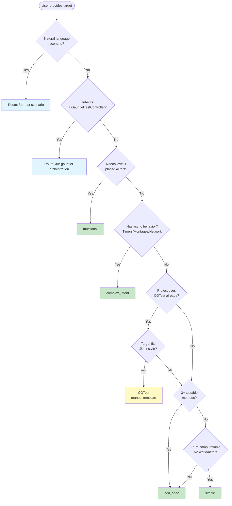

# UE Test Framework Advisor — Reference

## Framework Comparison Table

| Framework | Macro/Class | Style | Latent | World Required | Editor Required | Parameterized | Best For | UE 5.7 Status |
|-----------|------------|-------|--------|---------------|----------------|---------------|----------|---------------|
| **Simple** | `IMPLEMENT_SIMPLE_AUTOMATION_TEST` | 1 function = 1 test | No | No | No | No | Pure sync logic, math utilities, data validation | Stable, official |
| **BDD Spec** | `BEGIN_DEFINE_SPEC`/`END_DEFINE_SPEC` | Describe/It/BeforeEach | Yes (via commands) | Optional | No | Via Describe nesting | Multiple related behaviors, readable test organization | Stable, official |
| **Complex+Latent** | `IMPLEMENT_COMPLEX_AUTOMATION_TEST` + `DEFINE_LATENT_AUTOMATION_COMMAND` | Multi-frame with shared state | Yes | Usually | No | Via GetTests() | Async operations: timers, montages, network, AI ticks | Stable, official |
| **CQTest** | `TEST_CLASS`/`TEST_METHOD`/`TEST_CLASS_WITH_FLAGS` | JUnit-style class/method | Yes (via Commands) | Optional | No | No (as of 5.7) | Engine-internal tests, structured test suites | Official but underdocumented |
| **FunctionalTest** | `AFunctionalTest` subclass (Actor) | Actor placed in level | Yes (inherent) | Yes | Yes (PIE) | No | Visual tests in editor, level-specific behavior | Stable, official |
| **Gauntlet** | `UGauntletTestController` | RunUAT.bat orchestration | Yes | Yes (cooked) | No (standalone) | Via test config | CI/CD, cooked builds, soak tests, multi-platform | Experimental |
| **EditorUtility** | `UEditorUtilityTest` | Blueprint-compatible | Limited | Optional | Yes | No | Blueprint developer tests, editor tool validation | Experimental |

## Engine Source Distribution (Verified via MCP grep, 2026-03-29)

| Framework | Engine Source Count | Lyra Project Count | Notes |
|-----------|-------------------|-------------------|-------|
| `IMPLEMENT_SIMPLE_AUTOMATION_TEST` | 500+ | 500+ (NarshaMCP plugin tests) | Most common by far |
| `IMPLEMENT_COMPLEX_AUTOMATION_TEST` | 66 | 0 | MetaHuman, SourceControl, Animation |
| `BEGIN_DEFINE_SPEC` (BDD) | 143 | 0 | BuildPatchServices, Concert, Json, Xml |
| `TEST_CLASS` (CQTest) | 61 | 1 (ShooterTestsMapTests) | Audio, UAF, Landscape, PropertyEditor |
| `DEFINE_LATENT_AUTOMATION_COMMAND` | 149 | 0 | Paired with Complex tests |
| `AFunctionalTest` | engine only | 0 | FunctionalTesting plugin |
| `UGauntletTestController` | engine only | 1 (LyraTestControllerBootTest) | Experimental plugin |

**Key Insight**: Lyra itself uses almost no advanced test frameworks — just Simple tests and one Gauntlet boot test. Engine source heavily uses BDD Spec (Concert/Virtual Production team) and CQTest (Audio, Landscape, UAF/AnimNext).

## CQTest Deep Dive

### Location
`Engine/Plugins/Tests/CQTest/` — official UE plugin, ships with engine.

### API Pattern
```cpp
#include "CQTest.h"

// Basic test class
TEST_CLASS(MyTests, "Project.MyModule")
{
    TEST_METHOD(Should_Return_True_When_Valid)
    {
        bool Result = MyFunction(42);
        ASSERT_THAT(IsTrue(Result));
    }

    TEST_METHOD(Should_Handle_Negative_Input)
    {
        float Result = Calculate(-1.0f);
        ASSERT_THAT(IsNearlyEqual(Result, 0.0f));
    }
};

// With custom flags
TEST_CLASS_WITH_FLAGS(EditorOnlyTests, "Project.Editor",
    EAutomationTestFlags::EditorContext | EAutomationTestFlags::ProductFilter)
{
    TEST_METHOD(Verify_Asset_Creation) { /* ... */ }
};

// Network tests (PIE multi-client)
NETWORK_TEST_CLASS(ReplicationTest, "Project.Network")
{
    TEST_METHOD(Verify_State_Replication) { /* ... */ }
};
```

### Build.cs Setup
```csharp
// Add to PrivateDependencyModuleNames
"CQTest",
```

### Key Assertions (from CQTest)
- `ASSERT_THAT(IsTrue(expr))` / `ASSERT_THAT(IsFalse(expr))`
- `ASSERT_THAT(IsEqual(a, b))` / `ASSERT_THAT(IsNearlyEqual(a, b))`
- `ASSERT_THAT(IsNotNull(ptr))`
- `ASSERT_THAT(Contains(container, item))`

### Limitations (as of UE 5.7)
- No parameterized testing (cannot run same test with different data)
- Underdocumented — most knowledge from engine source reading
- `NETWORK_TEST_CLASS` exists but requires specific PIE setup
- C++ only — no Blueprint support

### When to Recommend CQTest
- Project already uses CQTest (detected via `#include "CQTest.h"` or `"CQTest"` in Build.cs)
- Target fits JUnit-style organization (multiple independent test methods per class)
- Engine-level or editor-level tests (not gameplay)

### When NOT to Recommend CQTest
- Game code (prefer BDD Spec or Simple for compatibility)
- New projects without CQTest dependency (adds module dependency)
- Tests requiring parameterization

## CQTest 5.8+ Enhanced API (Issue #8184 / #8187)

UE 5.8+ ships expanded CQTest helpers that the `cqtest` test_type's auto-decision matrix
(Issue #8187 / #8183 Phase 1) can emit. **None of these exist in 5.7** — generated code
wraps them in `#if ENGINE_MAJOR_VERSION > 5 || (ENGINE_MAJOR_VERSION == 5 && ENGINE_MINOR_VERSION >= 8)`
guards with a 5.7 fallback in `#else`.

### TestCommandBuilder — Async Test Chaining (replaces Complex+Latent for most cases)

```cpp
TestCommandBuilder
    .Do(TEXT("Setup"),     [&]() { /* arrange */ })
    .Until(TEXT("Wait"),   [&]() { return bReady; })       // poll-until
    .Then(                 [&]() { ASSERT_THAT(IsTrue(bResult)); })
    .DoAsync<FResult>(TEXT("Async"), [&]() { return StartAsync(); })
    .OnTearDown(           [&]() { Cleanup(); });          // LIFO cleanup
```

| Builder method | Purpose |
|---|---|
| `.Do(name, fn)` | Sequential step |
| `.Then(fn)` | Sequential step (no name) |
| `.Until(name, predicate, timeout?)` | Poll until predicate is true |
| `.DoAsync<T>(name, fn) → ThenAsync(callback)` | Kick off async + handle result |
| `.UntilAsync(...)` | Wait for async result |
| `.StartWhen(predicate)` | Gate before chain begins |
| `.WaitDelay(ms)` | Time-based wait (flakiness-prone, use sparingly) |
| `.OnTearDown(fn)` / `.CleanUpWith(fn)` | LIFO teardown |

### NETWORK_TEST_CLASS + FPIENetworkComponent — Replication Tests

```cpp
NETWORK_TEST_CLASS(MyNetTest, "Network.MyTest")
{
    struct State : public FBasePIENetworkComponentState
    {
        APawn* ReplicatedPawn;
    };
    FPIENetworkComponent<State> Network{ TestRunner, TestCommandBuilder, bInitializing };

    BEFORE_EACH()
    {
        FNetworkComponentBuilder<State>()
            .WithClients(2).AsDedicatedServer()
            .WithGameMode(AGameModeBase::StaticClass())
            .Build(Network);
    }

    TEST_METHOD(SpawnAndReplicate)
    {
        Network.SpawnAndReplicate<APawn, &State::ReplicatedPawn>()
            .ThenServer ([this](State& s) { ASSERT_THAT(IsNotNull(s.ReplicatedPawn)); })
            .ThenClients([this](State& s) { ASSERT_THAT(IsNotNull(s.ReplicatedPawn)); });
    }
};
```

| Helper | Purpose |
|---|---|
| `FNetworkComponentBuilder<S>` | Configure clients / GameMode / packet sim |
| `.ThenServer / .ThenClients / .ThenClient(idx)` | Per-role assertions |
| `.UntilServer / .UntilClients` | Per-role poll-until |
| `.SpawnAndReplicate<T, &State::Field>()` | Spawn + auto-replicate + assert |
| `.ThenClientJoins()` | Late-join replication test |

### TObjectBuilder — FProperty-based Builder Pattern

```cpp
TObjectBuilder<AMyActor>(Spawner)
    .SetParam(FName("Health"),  100.0f)
    .SetParam(FName("Name"),    FString("Hero"))
    .AddComponentTo<UMyComponent>()
    .Spawn();
```

Reflection-driven, type-safe, supports Actor + UObject, ChildActor attach. Replaces hand-written
`NewObject<>()` + property setter scaffolding for non-trivial fixtures.

### CQTestAssetHelper — AssetRegistry Integration

```cpp
FARFilter Filter = CQTestAssetHelper::FAssetFilterBuilder()
    .WithPackagePath(TEXT("/Game/Blueprints"))
    .Build();
UClass*  Class = CQTestAssetHelper::GetBlueprintClass(Filter, TEXT("BP_Enemy"));
UObject* Data  = CQTestAssetHelper::FindDataBlueprint(Filter, TEXT("DT_Weapons"));
```

Loads BP classes / DataAssets / DataBlueprints by name + filter — no hardcoded paths.

### FActorTestSpawner — Actor Tests Without PIE

```cpp
FActorTestSpawner Spawner;
AMyActor* Instance = Spawner.SpawnActor<AMyActor>();
// ...
// Spawner cleans up on destruction.
```

For Actor tests that don't need a full PIE world.

## Auto-Decision Matrix (Issue #8187 / #8183 Phase 1)

The `cqtest` test_type generator (`ue_generate_code(generate_test, test_type=cqtest)`) now
runs an auto-decision matrix over `pattern_detection` signals (Issue #10280) and the class
name. Each matched cell adds a `CQTestDecision` to the plan; the generator emits the
corresponding includes / Build.cs hint, wrapped in 5.8 `#if` guards when needed.

| # | Trigger | Decision (5.8) | 5.7 fallback |
|---|---|---|---|
| 1 | `UPROPERTY(Replicated)` / `ReplicatedUsing=` detected | `UseNetworkTestClass` → `NETWORK_TEST_CLASS` + `FPIENetworkComponent` | bare `TEST_CLASS` + `// TODO replication test (UE 5.8+)` |
| 2 | `SetTimer` / `SetTimerForNextTick` / `UKismetSystemLibrary::Delay` detected | `UseTestCommandBuilder` → `Do().Until().Then()` chain | `Complex+Latent` guidance comment |
| 3 | Class name matches `A*` UE Actor convention | `UseActorTestSpawner` → `FActorTestSpawner` | bare `NewObject<>()` |
| 4 | Class name matches `U*` non-Actor UObject convention | `UseObjectBuilder` → `TObjectBuilder<T>(Spawner).SetParam(...)` | bare `NewObject<>()` + setter calls |
| 6 | `function_count >= 2` | `GroupAsTestClass` → multiple `TEST_METHOD` in one `TEST_CLASS` | identical (no version gate) |
| 7 | Pure compute (no actor + no replicated) | `NoWorldNeeded` → `BEFORE_EACH` skips PIE | identical (no version gate) |

Cells 5 (`static` fn → `TEST()` shorthand) and 8 (BP asset reference → `CQTestAssetHelper`)
are tracked under #8183 follow-up — cell 5 needs PDB static-modifier plumbing, cell 8 needs
a 9th `DetectedPattern` variant.

### Build.cs Auto-Modification

When the matrix emits any 5.8+ decision, `apply_build_cs=true` (opt-in MCP param) appends
the required modules to `PrivateDependencyModuleNames`:

```csharp
PrivateDependencyModuleNames.AddRange(new string[] {
    "CQTest",
    "NetCore",  // when NETWORK_TEST_CLASS is in the plan
});
```

The default is `apply_build_cs=false` — generation surfaces the planned change as a warning
(`"Build.cs would gain PrivateDependencyModuleNames: …"`) so the developer can review before
opting in.

## BDD Spec Pattern

### API
```cpp
#include "Misc/AutomationTest.h"

BEGIN_DEFINE_SPEC(FMyCharacterSpec, "Game.MyCharacter",
    EAutomationTestFlags::EditorContext | EAutomationTestFlags::EngineFilter | EAutomationTestFlags::SmokeFilter)
    // Shared state
    AMyCharacter* TestCharacter;
    UWorld* TestWorld;
END_DEFINE_SPEC(FMyCharacterSpec)

void FMyCharacterSpec::Define()
{
    BeforeEach([this]()
    {
        TestWorld = FAutomationEditorCommonUtils::CreateNewMap();
        TestCharacter = TestWorld->SpawnActor<AMyCharacter>();
    });

    AfterEach([this]()
    {
        if (TestCharacter) TestCharacter->Destroy();
    });

    Describe("TakeDamage", [this]()
    {
        It("should reduce health", [this]()
        {
            TestCharacter->TakeDamage(50.f, FDamageEvent(), nullptr, nullptr);
            TestEqual("Health reduced", TestCharacter->GetHealth(), 50.f);
        });

        It("should trigger death at zero", [this]()
        {
            TestCharacter->TakeDamage(100.f, FDamageEvent(), nullptr, nullptr);
            TestTrue("Character is dead", TestCharacter->IsDead());
        });
    });
}
```

### When to Recommend BDD Spec
- Target has 3+ related behaviors (Given/When/Then expressible)
- Test readability matters (team reviews tests)
- Need shared setup/teardown (BeforeEach/AfterEach)
- Default recommendation when no strong signal for other frameworks

## Complex+Latent Pattern

### API
```cpp
// Shared state structure
struct FMyTestState
{
    AMyCharacter* Character = nullptr;
    bool bCompleted = false;
    float ElapsedTime = 0.f;
};

// Latent command
DEFINE_LATENT_AUTOMATION_COMMAND_ONE_PARAMETER(FWaitForAnimation, TSharedPtr<FMyTestState>, State);
bool FWaitForAnimation::Update()
{
    State->ElapsedTime += FApp::GetDeltaTime();
    if (State->ElapsedTime > 5.0f)
    {
        // Timeout
        return true;
    }
    return State->bCompleted;
}

// Test class
IMPLEMENT_COMPLEX_AUTOMATION_TEST(FMontageTest, "Game.Animation.Montage",
    EAutomationTestFlags::EditorContext | EAutomationTestFlags::ProductFilter)

void FMontageTest::GetTests(TArray<FString>& OutBeautifiedNames, TArray<FString>& OutTestCommands) const
{
    OutBeautifiedNames.Add("PlayMontage");
    OutTestCommands.Add("PlayMontage");
}

bool FMontageTest::RunTest(const FString& Parameters)
{
    auto State = MakeShared<FMyTestState>();
    // Setup
    ADD_LATENT_AUTOMATION_COMMAND(FWaitForAnimation(State));
    return true;
}
```

### When to Recommend Complex+Latent
- Multi-frame async: timers, animation montages, AI behavior trees
- Network replication requiring frame advancement
- Operations with callbacks/delegates that fire later
- Movement/physics tests needing world tick

## Multiplayer Test Patterns

**No standard UE framework exists for multiplayer testing.** Available approaches:

1. **CQTest `NETWORK_TEST_CLASS`** — Engine-internal, spawns PIE clients. Underdocumented.
2. **Complex+Latent with custom world** — Manually create server + client `UWorld` instances:
   ```cpp
   // Create standalone server world
   UWorld* ServerWorld = UWorld::CreateWorld(EWorldType::Game, false);
   // Simulate client connection
   // This requires significant boilerplate
   ```
3. **Gauntlet** — For full-stack cooked build testing with multiple processes.
4. **NetcodeUnitTest** — Engine plugin at `Plugins/NetcodeUnitTest/`, provides `UClientUnitTest` base class for netcode testing.

**Recommendation**: For network replication tests, recommend Complex+Latent with replication setup boilerplate. For full multiplayer stack, recommend Gauntlet via `/ue-gauntlet-orchestration`.

## Decision Tree (Mermaid)



## A/B Test Design (Issue #7600)

### Test 1: Framework Selection Accuracy
| Aspect | A: Rule-based (this skill) | B: LLM free-form judgment |
|--------|---------------------------|--------------------------|
| Method | Decision tree (8 rules, first match) | Claude analyzes target and reasons freely |
| Metric | Agreement with expert recommendation on 20 test targets | Same |
| Expected | Higher consistency, lower accuracy on edge cases | Higher accuracy on edge cases, less consistent |

### Test 2: Integration Approach
| Aspect | A: Standalone skill | B: Phase 0 in /ue-test-gen |
|--------|--------------------|-----------------------------|
| Method | Separate `/ue-test-framework-advisor` | Add framework selection step to `/ue-test-gen` |
| Metric | User satisfaction, skip rate (how often users bypass) | Same |
| Expected | Clearer separation, extra step | Fewer steps, but bloats /ue-test-gen |

### Test 3: Code Generation Quality
| Aspect | A: ue_generate_code only | B: Advisor + ue_generate_code |
|--------|-------------------------|-------------------------------|
| Method | Direct `ue_generate_code(test_type="bdd_spec")` | Advisor recommends → passes context → ue_generate_code |
| Metric | Compile success rate, test coverage of target | Same |
| Expected | Good for bdd_spec default | Better for complex_latent/functional edge cases |

## Version History

| Version | Date | Changes |
|---------|------|---------|
| 1.0.0 | 2026-03-29 | Initial release. 7 frameworks, 8-rule decision tree, 4-phase workflow |
